# Лабораторная работа № 4 — Amazon S3: хранение вложений TimeCapsule

**Дисциплина:** Cloud Computing  
**Уровень:** продвинутый (задания 1–14)  
**Студент:** Герганов Артём  
**Группа:** IA2404  
**Специальность:** Прикладная информатика  
**Университет:** Государственный университет Молдовы (USM), факультет математики и информатики  
**Репозиторий:** https://github.com/Artimon4ik-cloud/timecapsule

## 1. Цель работы

Изучить Amazon Simple Storage Service (S3), настроить защищённое объектное хранилище, управление версиями, жизненный цикл объектов и права доступа IAM. Интегрировать S3 с существующим PHP-приложением **TimeCapsule**, перенести вложения с локального диска EC2 в S3, реализовать выдачу временных подписанных ссылок и подтвердить принцип минимальных привилегий.

## 2. Используемые ресурсы

| Компонент | Назначение / конфигурация |
|---|---|
| AWS Region | `eu-central-1` (Frankfurt) |
| Amazon S3 | `timecapsule-dev-uploads-artimon4ik` |
| Префиксы объектов | `uploads/`, `backups/` (учебные операции) |
| EC2 приложения | `timecapsule-dev-app-server` |
| EC2 базы данных | PostgreSQL, внутреннее имя `db.timecapsule.internal` |
| Приложение | PHP TimeCapsule, AWS SDK for PHP |
| IAM Role EC2 | `timecapsule-dev-ec2-s3-role` |
| IAM Policy | `timecapsule-dev-s3-policy` |
| Шифрование | SSE-S3 |
| Сеть | VPC, разделение серверов приложения и БД |
| Доступ к вложениям | Временные S3 Presigned URL (5 минут) |

> **Примечание:** для отчёта приведены имена учебных ресурсов, но не публикуются ключи доступа, токены или действующие подписанные URL. Скриншоты из предоставленного архива включены в папку `screenshots/`.

## 3. Выполнение работы

### Задание 1. Создание бакета и загрузка объектов

В регионе `eu-central-1` создан бакет `timecapsule-dev-uploads-artimon4ik`. Для него настроены запрет публичного доступа (**Block all public access**), отключённые ACL (Object Ownership / Bucket owner enforced) и шифрование **SSE-S3**. Файлы размещаются по ключам с префиксами, например `uploads/example.pdf` и `backups/report.txt`.

В Amazon S3 «папка» не является обычным каталогом файловой системы: это часть **ключа объекта**. У объекта доступны Key, размер, Content-Type, ETag и Object URL. Прямая публичная ссылка не даёт доступ к приватному объекту без соответствующих разрешений.

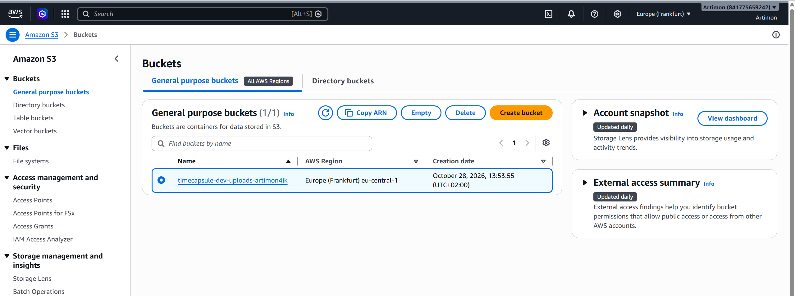

### Задание 2. Работа с S3 через AWS CLI

Для загрузки, синхронизации, просмотра метаданных и удаления файлов использовались команды AWS CLI. Типовые операции:

```bash
BUCKET=timecapsule-dev-uploads-artimon4ik
aws s3 cp photo.txt "s3://$BUCKET/uploads/photo.txt"
aws s3 sync ./uploads "s3://$BUCKET/uploads/"
aws s3 ls "s3://$BUCKET/"
aws s3 ls "s3://$BUCKET/uploads/"
aws s3 ls "s3://$BUCKET/uploads/" --recursive
aws s3api head-object --bucket "$BUCKET" --key uploads/photo.txt
aws s3 cp "s3://$BUCKET/uploads/photo.txt" ./photo.txt
aws s3 rm "s3://$BUCKET/uploads/report-2.txt"
```

`cp` переносит отдельный файл, `sync` сравнивает источник и назначение и передаёт недостающие или изменённые объекты, `ls` выводит список, а `head-object` получает метаданные без скачивания содержимого. В ходе работы команды AWS CLI применялись также при миграции реальных вложений приложения.

### Задание 3. Защита соединения политикой бакета

Для бакета настроена политика с явным запретом запросов, не использующих HTTPS. Логика политики:

```json
{
  "Effect": "Deny",
  "Principal": "*",
  "Action": "s3:*",
  "Resource": [
    "arn:aws:s3:::timecapsule-dev-uploads-artimon4ik",
    "arn:aws:s3:::timecapsule-dev-uploads-artimon4ik/*"
  ],
  "Condition": {
    "Bool": { "aws:SecureTransport": "false" }
  }
}
```

При HTTPS-запросах применяются обычные разрешения IAM; при HTTP-запросах срабатывает **Explicit Deny**, имеющий приоритет над разрешающими правилами.

### Задание 4. Версионирование объектов

Для бакета включено **Bucket Versioning**. Оно позволяет сохранять несколько версий одного ключа. При обычном удалении объекта в версионируемом бакете создаётся **Delete marker**; прежние версии остаются доступными через историю версий до их отдельного удаления или обработки Lifecycle.

В учебной проверке рассматривалась последовательность `notes.txt` v1 → v2 → удаление (Delete marker) → восстановление удалением маркера → возврат к предыдущей версии. В реальном приложении наличие Delete marker после удаления вложения также подтверждено.

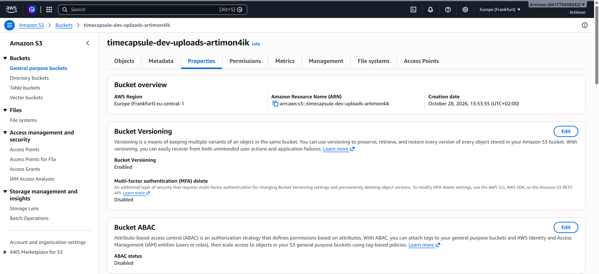

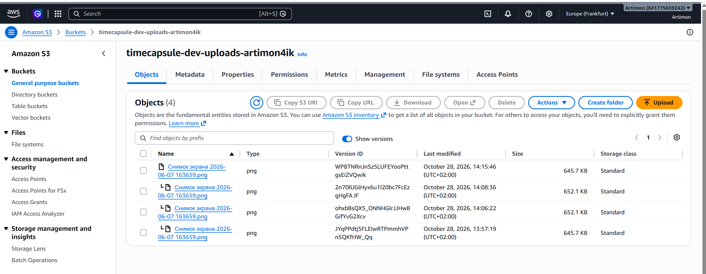

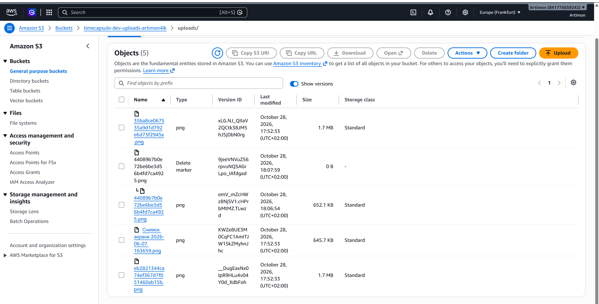

### Задание 5. Настройка Lifecycle

Создано и включено правило **`timecapsule-dev-noncurrent`** для префикса `uploads/`:

| Условие | Действие |
|---|---|
| Неактуальная версия существует 30 дней | Перевод в Standard-IA (для подходящих объектов) |
| Неактуальная версия существует 90 дней | Постоянное удаление |
| Сохранение последних версий | 2 более новые версии |
| Незавершённая multipart-загрузка старше 7 дней | Удаление |

Переход в Standard-IA зависит от ограничений S3, в частности от минимального размера объектов для перехода. Lifecycle позволяет автоматизировать хранение и очистку старых версий.

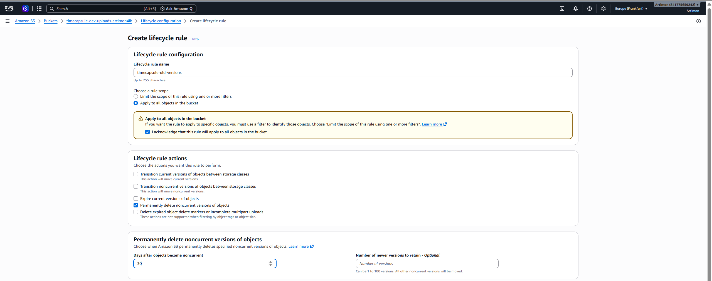

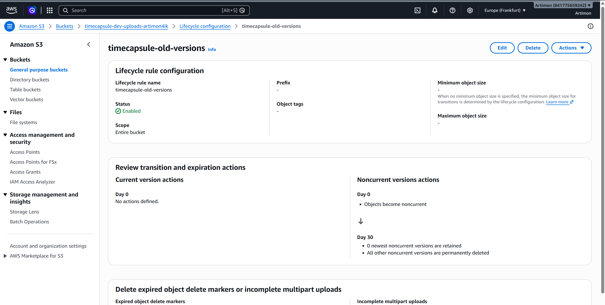

### Задание 6. Временные подписанные ссылки

Проверялось предоставление временного доступа к приватному объекту через **Presigned URL**. Для демонстрации применялись ссылки на ограниченный срок (в том числе CLI-команда `aws s3 presign ... --expires-in 120`). Подписанная ссылка содержит параметры алгоритма подписи, срока действия и подписи запроса; изменение пути объекта после подписания делает подпись недействительной.

В интегрированном приложении использована ссылка сроком **300 секунд**. После истечения времени S3 вернул:

```xml
<Error>
  <Code>AccessDenied</Code>
  <Message>Request has expired</Message>
  <X-Amz-Expires>300</X-Amz-Expires>
</Error>
```

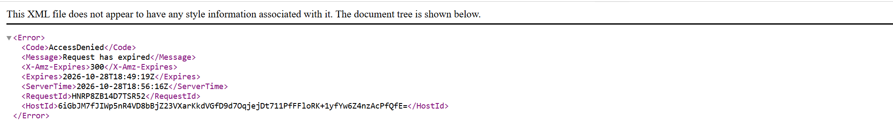

### Задание 7. IAM-политика минимальных привилегий

Создана IAM-политика `timecapsule-dev-s3-policy`. На этапе первоначального тестирования доступ к списку объектов ограничивался префиксом `uploads/`, а чтение, загрузка и удаление — объектами `uploads/*`. Доступ к `backups/*`, управлению бакетом и удалению конкретных версий не предоставлялся.

На завершающем этапе (задание 13) право **`s3:ListBucket` было удалено** как необязательное для работы PHP-приложения. В итоговой конфигурации оставлены операции `s3:GetObject`, `s3:PutObject`, `s3:DeleteObject` для `arn:aws:s3:::timecapsule-dev-uploads-artimon4ik/uploads/*`.

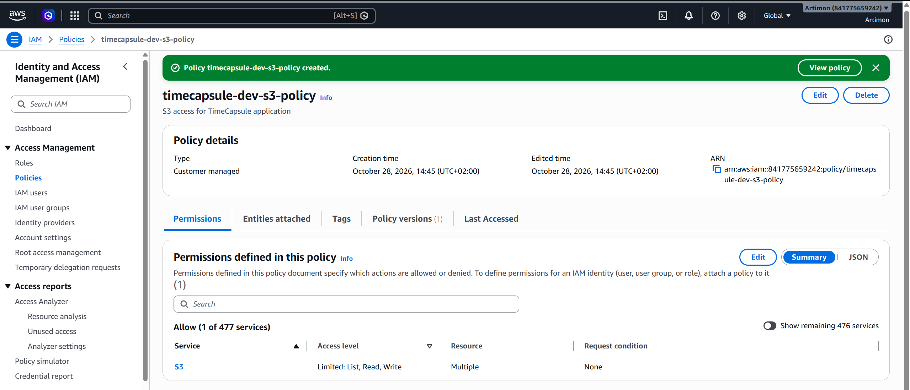

### Задание 8. Проверка разрешений тестовой IAM-роли

Для проверки принципа минимальных привилегий использовалась тестовая роль `timecapsule-dev-s3-tester` и временные учётные данные AWS STS (`AssumeRole`). Таблица отражает **ожидаемые результаты для первоначальной политики, до удаления `ListBucket` в задании 13**. В предоставленном архиве нет отдельного снимка вывода всех десяти команд; таблица фиксирует сценарии тестирования, а не выдаёт отсутствующие логи за документальное доказательство.

| № | Операция | Ожидаемый результат (исходная политика) | Причина |
|---:|---|---|---|
| 1 | `PutObject uploads/test.txt` | Allow | Разрешён `PutObject` для `uploads/*` |
| 2 | `ListBucket uploads/` | Allow | Исходное разрешение списка для `uploads/` |
| 3 | `ListBucket` корня бакета | Deny | Префикс вне разрешённого списка |
| 4 | `GetObject uploads/photo.txt` | Allow | Разрешён `GetObject` |
| 5 | `ListBucket backups/` | Deny | Префикс `backups/` не разрешён |
| 6 | `PutObject backups/test.txt` | Deny | Запись вне `uploads/*` |
| 7 | `ListBucketVersions` | Deny | Нет `s3:ListBucketVersions` |
| 8 | `DeleteObjectVersion` с `--version-id` | Deny | Нет `s3:DeleteObjectVersion` |
| 9 | `DeleteObject uploads/test.txt` | Allow | Разрешён `DeleteObject` (создаётся Delete marker) |
| 10 | Список `uploads/` через HTTP | Deny | Явный запрет небезопасного транспорта |

После завершения проверки временные переменные окружения с учётными данными роли необходимо удалить. В финальной политике операция № 2 также становится запрещённой, поскольку `ListBucket` удалён намеренно.

### Задание 9. IAM Role для EC2

Создана роль `timecapsule-dev-ec2-s3-role`, связанная с EC2 приложения. Это позволяет AWS SDK и AWS CLI получать **временные credentials автоматически через роль экземпляра**, без сохранения постоянных Access Key и Secret Key в исходном коде или `.env`.

Подключение к экземпляру выполнялось через AWS Systems Manager Session Manager. Доступ к S3 из EC2 подтверждался AWS CLI.

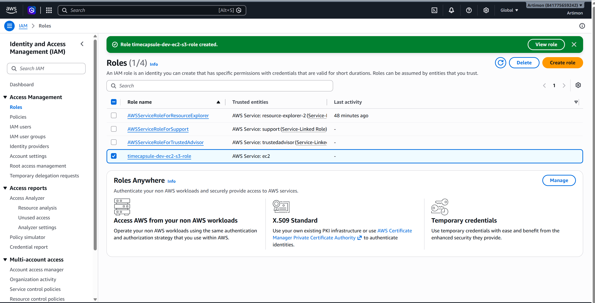

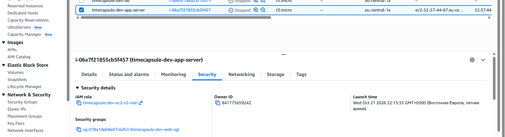

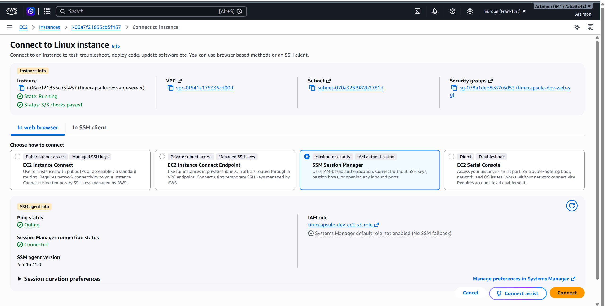

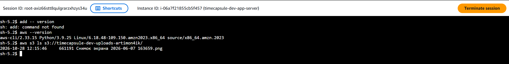

### Задание 10. Перенос существующих вложений

Ранее вложения TimeCapsule хранились в локальном каталоге `storage/uploads`. Перед переносом проверялась синхронизация с `--dryrun`, затем файлы были перенесены в `s3://timecapsule-dev-uploads-artimon4ik/uploads/`. Повторная синхронизация не должна повторно передавать неизменённые объекты.

После миграции старые изображения открывались из S3. Локальные копии были удалены, в каталоге оставлен служебный `.gitkeep`.

```bash
aws s3 sync storage/uploads s3://timecapsule-dev-uploads-artimon4ik/uploads/ --dryrun
aws s3 sync storage/uploads s3://timecapsule-dev-uploads-artimon4ik/uploads/
```

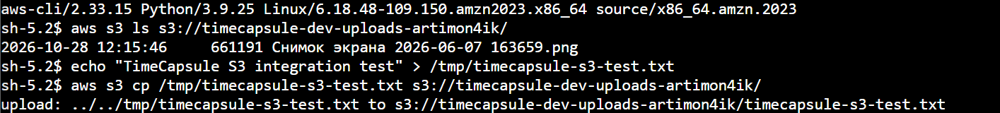

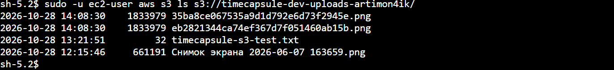

### Задание 11. Интеграция PHP с Amazon S3

В приложении установлен **AWS SDK for PHP**, а работа с вложениями сосредоточена в `src/storage.php`. Реализованы функции:

- `storage_driver()` — выбор `local` либо `s3`;
- `storage_s3_client()` — клиент S3, использующий IAM Role экземпляра;
- `storage_save()` — сохранение вложения через `PutObject`;
- `storage_delete()` — удаление через `DeleteObject`;
- `storage_stream()` — создание подписанного запроса `GetObject` и HTTP-перенаправление `302`.

Основные переменные окружения:

```dotenv
STORAGE_DRIVER=s3
AWS_REGION=eu-central-1
S3_BUCKET=timecapsule-dev-uploads-artimon4ik
```

В AWS SDK **не передаются статические ключи доступа**. Для загрузки файлов добавлена явная установка `ContentType`: `application/pdf` для PDF, `image/png` для PNG и `image/jpeg` для JPG/JPEG. Исправление отправлено в ветку `main` коммитом `fb525be`.

Пример ключевой части кода:

```php
$mimeTypes = [
    'pdf' => 'application/pdf',
    'png' => 'image/png',
    'jpg' => 'image/jpeg',
    'jpeg' => 'image/jpeg',
];
$contentType = $mimeTypes[strtolower($extension)] ?? 'application/octet-stream';

storage_s3_client()->putObject([
    'Bucket' => config('S3_BUCKET'),
    'Key' => 'uploads/' . $storedName,
    'SourceFile' => $uploadedFile['tmp_name'],
    'ContentType' => $contentType,
]);
```

### Задание 12. Проверка приложения и вложений

Проведены функциональные проверки:

| Проверка | Результат |
|---|---|
| Создание капсулы с PNG | Успешно, объект появляется в `uploads/` |
| Просмотр ранее загруженных изображений | Успешно после миграции в S3 |
| Удаление PNG | Успешно, в истории версий виден Delete marker |
| Создание капсулы с PDF | Успешно, объект сохранён в S3 |
| `Content-Type` нового PDF | `application/pdf` |
| Скачивание PDF под исходным именем | Успешно: `Mini_Forum_Report (1).pdf` (браузер потребовал подтвердить незащищённую загрузку) |
| Временный доступ по S3 URL | Успешно до истечения срока |
| Повторное открытие того же URL после 5 минут | `AccessDenied` / `Request has expired` |

Первоначально PDF сохранялся с `application/octet-stream`. После исправления `storage_save()` повторная загрузка подтвердила `application/pdf`. В Chrome возникло предупреждение о небезопасном скачивании из приложения по HTTP; после подтверждения файл сохранился. Это отдельный вопрос HTTPS-конфигурации веб-приложения, не ошибка сохранения объекта в S3.

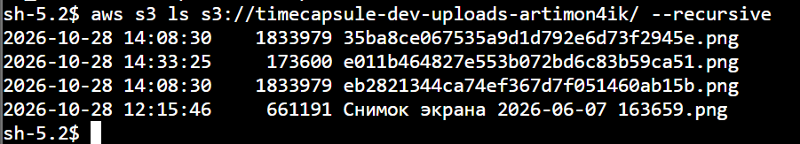

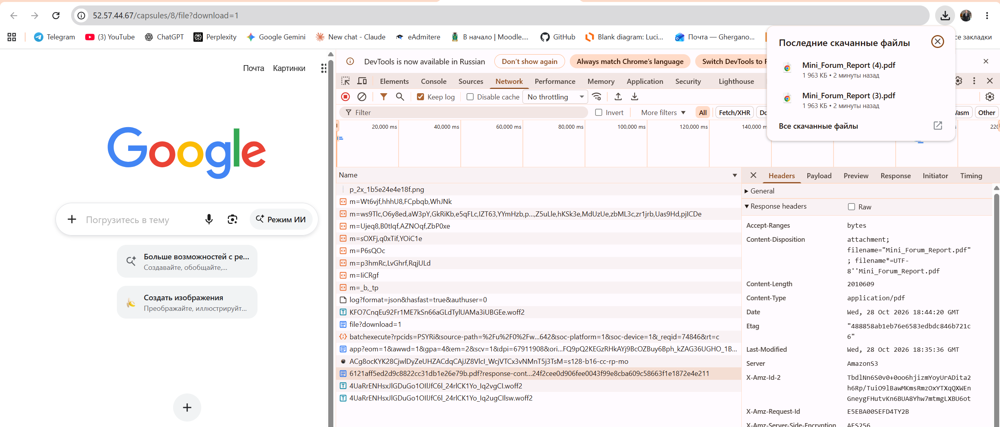


### Задание 13. Stateless-приложение и отказ от ListBucket

После миграции приложение не зависит от локального хранения загруженных файлов: вложения размещаются в S3, а сервер EC2 выполняет обработку запросов и создаёт подписанные ссылки. Из IAM-политики удалено `s3:ListBucket`, поскольку приложению известен конкретный ключ вложения и не требуется перечислять объекты.

Проверка в EC2:

```bash
aws s3 ls s3://timecapsule-dev-uploads-artimon4ik/uploads/
# AccessDenied: ListObjectsV2
```

Для несуществующего объекта `uploads/no-such-file.txt` сравнивались ответы при разных разрешениях:

- с административными разрешениями и возможностью проверки существования объекта: **404 Not Found**;
- из роли EC2 без `ListBucket`: **403 Forbidden**.

Это ожидаемое поведение S3: без права перечисления бакета сервис не раскрывает факт отсутствия объекта. При этом работа приложения с известными ключами (Get/Put/Delete) сохраняется.

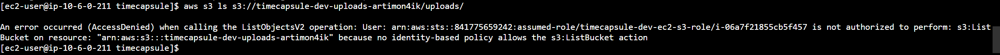

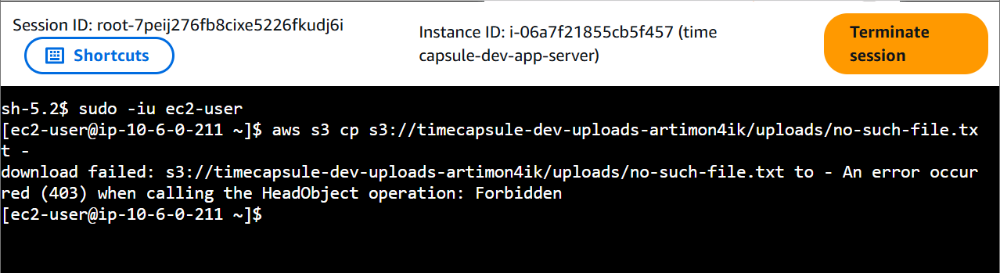

### Задание 14. Архитектура и ADR

Подготовлена схема размещения компонентов TimeCapsule в AWS. Приложение и PostgreSQL находятся на отдельных EC2 в VPC; вложения хранятся в Amazon S3 **вне VPC**, но в том же регионе AWS. Приложение обращается к S3 через IAM Role. Браузер получает объект непосредственно из S3 по краткосрочной подписанной ссылке.

.png>)


Архитектурное решение описано в [ADR 0003 — Attachment Storage](../../adr/0003-attachment-storage.md) (путь предполагает размещение этого отчёта в `docs/lab4/` существующего репозитория).

**Сравнение вариантов хранения:**

| Критерий | EBS | EFS | S3 |
|---|---|---|---|
| Модель | Блочный диск EC2 | Сетевая файловая система | Объектное хранилище |
| Масштабирование | Ограничено томом и привязкой | Общее файловое пространство | Масштабируемые объекты |
| Связь с EC2 | Сильная | Требуется монтирование | Доступ через API |
| Подходит для вложений | Возможно, но усложняет переносимость | Подходит для общего POSIX-хранилища | **Выбрано для TimeCapsule** |
| Временные ссылки для браузера | Требуется реализовать отдельно | Требуется реализовать отдельно | Поддерживаются Presigned URL |

**Последствия решения:** приложение становится менее зависимым от конкретного EC2; приватные объекты можно выдавать без публичного бакета; Versioning и Lifecycle помогают управлять версиями и стоимостью. При дальнейшем масштабировании возможны несколько экземпляров приложения за Load Balancer, поскольку вложения не привязаны к их локальным дискам. Для полноценной эксплуатации также необходимо настроить HTTPS на уровне веб-приложения или балансировщика.

## 4. Ответы на контрольные вопросы

**1. Что такое Amazon S3?**  
Amazon S3 — управляемое объектное хранилище AWS. Данные сохраняются как объекты внутри бакетов, каждый объект имеет уникальный ключ и метаданные.

**2. Чем S3 отличается от обычной файловой системы?**  
S3 использует API для операций с объектами и не предоставляет обычную POSIX-файловую систему. «Папки» в консоли формируются на основе префиксов ключей, а не являются самостоятельными каталогами.

**3. Зачем нужен Block Public Access?**  
Он помогает предотвратить случайную публикацию объектов или бакета. В TimeCapsule вложения остаются приватными, а доступ пользователю выдаётся временно через подписанную ссылку.

**4. Что такое ACL и почему они отключены?**  
ACL — списки контроля доступа на уровне бакета и объекта. В режиме Bucket owner enforced управление доступом осуществляется через IAM и bucket policies, что упрощает модель безопасности.

**5. Для чего используется Bucket Policy?**  
Bucket Policy задаёт ресурсные правила доступа к бакету и объектам. В этой работе она запрещает операции через HTTP с помощью условия `aws:SecureTransport=false`.

**6. В чём разница между IAM Policy и Bucket Policy?**  
IAM Policy назначается пользователю или роли и определяет доступ этого субъекта. Bucket Policy прикрепляется к самому бакету и может разрешать либо запрещать запросы к ресурсу; явный Deny имеет приоритет.

**7. Что делает Versioning?**  
Versioning сохраняет несколько версий одного объекта. Обычное удаление добавляет Delete marker, поэтому предыдущие версии можно восстановить, пока они не удалены окончательно.

**8. Для чего нужен Lifecycle?**  
Lifecycle автоматически выполняет переходы между классами хранения и удаление объектов или версий по правилам. Это сокращает ручную работу и помогает контролировать расходы.

**9. Что такое Presigned URL и чем он безопаснее публичного объекта?**  
Presigned URL — подписанная ссылка, предоставляющая временный доступ к определённому объекту и операции. Она позволяет оставить бакет приватным, ограничить срок доступа и не передавать клиенту IAM-ключи.

**10. Что произойдёт при изменении пути в подписанной ссылке?**  
Подпись рассчитывается для конкретного запроса, включая путь и параметры. Изменение ключа объекта после формирования ссылки приводит к несовпадению подписи и отказу в доступе.

**11. Зачем EC2 нужна IAM Role?**  
Роль позволяет приложению автоматически получать временные AWS credentials через инфраструктуру экземпляра. Это безопаснее, чем хранить постоянные ключи доступа в PHP-файлах или переменных окружения.

**12. Почему следует применять принцип минимальных привилегий?**  
Он ограничивает ущерб при ошибке приложения или компрометации учётных данных. TimeCapsule нужны только операции чтения, записи и удаления объектов в `uploads/*`, поэтому `ListBucket` и доступ к другим префиксам исключены.

**13. Почему S3 может возвращать 403 вместо 404?**  
Если объект отсутствует, но у вызывающего нет `s3:ListBucket`, S3 может вернуть 403 Forbidden. Это не раскрывает информацию о существовании ключей в бакете пользователю без соответствующих прав.

**14. Что такое ETag и Content-Type?**  
ETag — идентификатор версии содержимого объекта, который часто используется при проверках и условных запросах; он не всегда равен MD5. Content-Type сообщает клиенту MIME-тип содержимого, например `application/pdf` или `image/png`.

**15. Почему для TimeCapsule выбран S3 вместо EBS/EFS?**  
Вложения являются самостоятельными объектами и не требуют POSIX-доступа. S3 упрощает независимость приложения от EC2, поддерживает приватные объекты, Presigned URL, версионирование и Lifecycle.

**16. Что означает stateless для приложения?**  
Stateless означает, что важные пользовательские файлы и состояние не должны зависеть от локального диска конкретного веб-сервера. В TimeCapsule вложения находятся в S3, а данные приложения — в PostgreSQL, что упрощает замену и масштабирование EC2.

## 5. Итоговые результаты

В ходе лабораторной работы создан защищённый бакет S3, настроены SSE-S3, Block Public Access, Versioning, Lifecycle и запрет HTTP. Приложение TimeCapsule переведено с локального хранения вложений на Amazon S3 с использованием IAM Role и AWS SDK for PHP. Проверены загрузка PNG/PDF, миграция старых вложений, удаление с Delete marker, корректный MIME-тип PDF, скачивание под исходным именем и истечение Presigned URL через пять минут. Дополнительно подтверждено, что удаление права `ListBucket` не мешает основным операциям приложения, но ограничивает возможность перечисления объектов.

**Вывод:** Amazon S3 обеспечивает более подходящее для TimeCapsule масштабируемое и управляемое хранение вложений, чем локальный каталог EC2. Архитектура поддерживает принцип минимальных привилегий и создаёт основу для последующего развёртывания нескольких серверов приложения.

## 6. Материалы

- [Исходный код TimeCapsule](https://github.com/Artimon4ik-cloud/timecapsule)
- [ADR 0003 — выбор хранилища вложений](../../adr/0003-attachment-storage.md)
- [AWS S3 Documentation](https://docs.aws.amazon.com/AmazonS3/latest/userguide/Welcome.html)
- [AWS SDK for PHP — S3](https://docs.aws.amazon.com/sdk-for-php/v3/developer-guide/s3-examples.html)
- Скриншоты и схема архитектуры: `docs/lab4/screenshots/`.
