# Лабораторная работа №5 — Amazon RDS и миграция PostgreSQL

**Дисциплина:** Cloud Computing  
**Студент:** Герганов Артём  
**Группа:** IA2404  


## Цель работы

Изучить развёртывание и эксплуатацию управляемой реляционной базы данных Amazon RDS for PostgreSQL, настройку доступа из VPC, репликацию чтения, восстановление на определённый момент времени (PITR), а также выполнить миграцию действующего приложения TimeCapsule с PostgreSQL на EC2 на Amazon RDS. Проверить работоспособность приложения при перезапуске и остановке базы данных, настроить автоматизацию и изучить аудит AWS CloudTrail.

## Используемые сервисы и инструменты

Amazon RDS for PostgreSQL, Amazon EC2, Amazon VPC, Security Groups, DB Subnet Groups, Amazon Route 53 (Private Hosted Zone), Amazon EventBridge Scheduler, AWS IAM, Amazon CloudWatch, AWS CloudTrail, PostgreSQL (`psql`, `pg_dump`, `pg_restore`), PHP/PDO, Amazon S3.

> **Примечание о соответствии требованиям:** Работа выполнена на AWS Free Plan. Из-за ограничений тарифа период хранения автоматических резервных копий оставлен равным **1 дню** вместо требуемых 7 дней. В расширенной части использован уже созданный экземпляр `lab5-db`, а не отдельный RDS с именем `timecapsule-dev-rds`; имена базы и пользователя приложения также отличаются от предложенных в задании. Тест фактического срабатывания EventBridge Scheduler не проводился. Старый EC2-сервер БД остановлен, но не удалён окончательно.

---

## Часть I. Работа с Amazon RDS

### Задание 1. Сеть и DB Subnet Group

Для размещения управляемой базы данных использована VPC `timecapsule-dev-vpc` (`10.6.0.0/16`). Подготовлена DB Subnet Group `lab5-db-subnets`, включающая приватные подсети в двух зонах доступности `eu-central-1a` и `eu-central-1b`. Наличие подсетей в двух AZ удовлетворяет требованиям сетевой конфигурации RDS, однако само по себе не означает, что экземпляр работает в Multi-AZ.

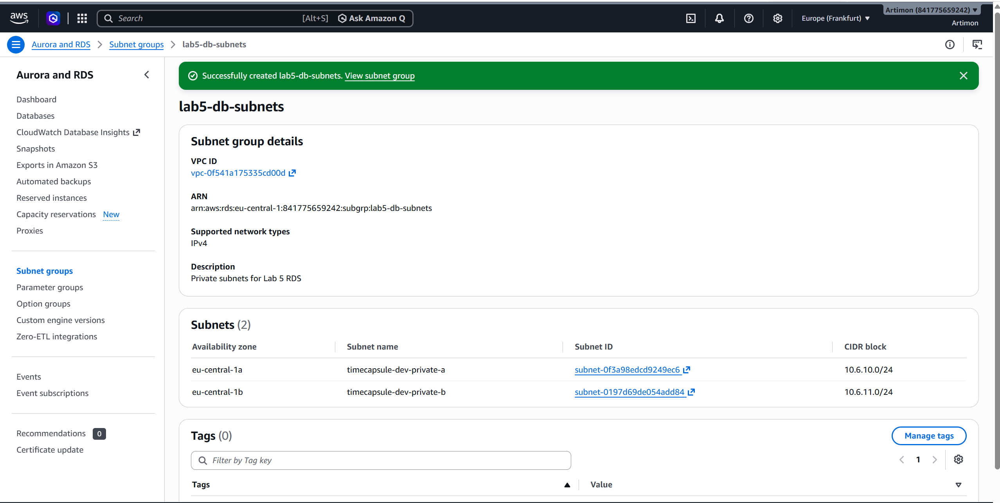

Создана группа безопасности `lab5-rds-sg`. Входящие соединения PostgreSQL по TCP-порту **5432** разрешены только от группы безопасности сервера приложения, а не из интернета.

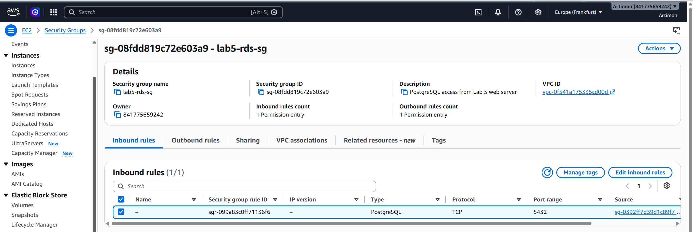

### Задание 2. Создание приватного PostgreSQL в RDS

Создан экземпляр `lab5-db` с параметрами:

| Параметр | Значение |
|---|---|
| Сервис | Amazon RDS for PostgreSQL |
| Идентификатор | `lab5-db` |
| Версия PostgreSQL | 18.3 |
| Класс | `db.t4g.micro` |
| Хранилище | 20 GiB, gp3 |
| Развёртывание | Single-AZ |
| VPC | `timecapsule-dev-vpc` |
| Публичная доступность | Отключена |
| Порт | 5432 |
| Шифрование хранилища | Включено |
| Автоматическое резервное копирование | Включено, 1 день |

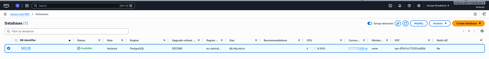

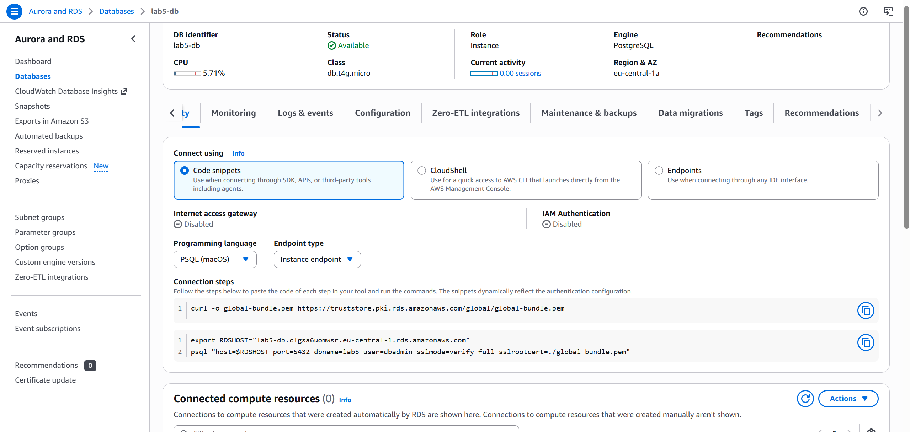

Первоначально планировалось использовать семидневное хранение автоматических резервных копий, но AWS отклонил такое изменение из-за ограничений Free Plan. Поэтому сохранён максимально доступный в текущем аккаунте срок — 1 день.

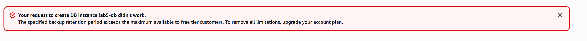

### Задание 3. Подключение к PostgreSQL и SQL-операции

Соединение с RDS проверено с помощью клиента `psql` с EC2-узла внутри VPC. Для соединения использовался приватный endpoint RDS, порт 5432 и SSL/TLS. В учебной базе `lab5` создана таблица заметок `notes`, после чего выполнены SQL-операции вставки и выборки данных.

Пример проверки подключения (без публикации пароля):

```bash
psql "host=<RDS_ENDPOINT> port=5432 dbname=lab5 user=dbadmin sslmode=require"
```

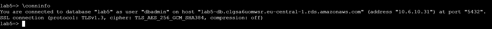

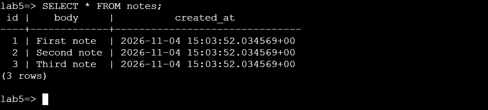

### Задание 4. Read Replica и задержка репликации

Для основного RDS создана реплика чтения (Read Replica). После перехода реплики в доступное состояние проверено наличие перенесённых записей. Попытка изменения данных непосредственно на реплике показала, что она предназначена для операций чтения.

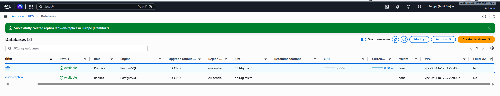

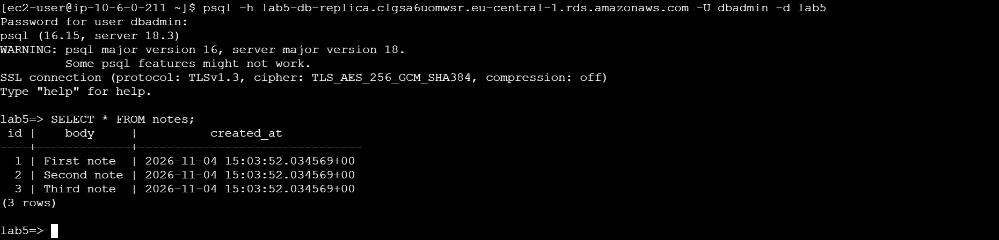

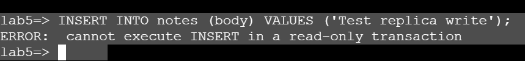

Для проверки репликации данные изменялись на основном экземпляре, после чего сравнивалось количество записей на основном RDS и Read Replica. В результате обе базы содержали четыре записи.

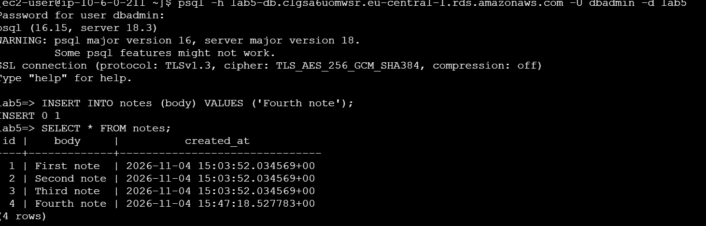

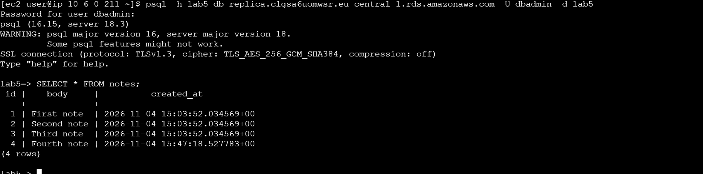

В Amazon CloudWatch изучена метрика **ReplicaLag**, показывающая задержку доставки изменений от основного экземпляра к реплике. Конкретное числовое значение задержки в отчёте не фиксируется без отдельного замера.

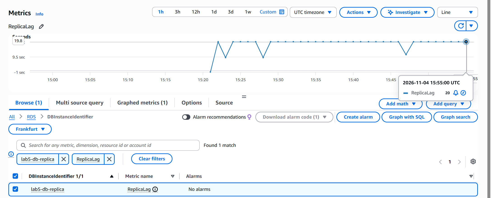

### Задание 5. Восстановление на определённый момент времени (PITR)

Для демонстрации PITR сначала зафиксировано время, когда таблица `notes` ещё содержала четыре записи. Затем часть данных была удалена, что позволило смоделировать ошибочную операцию пользователя.

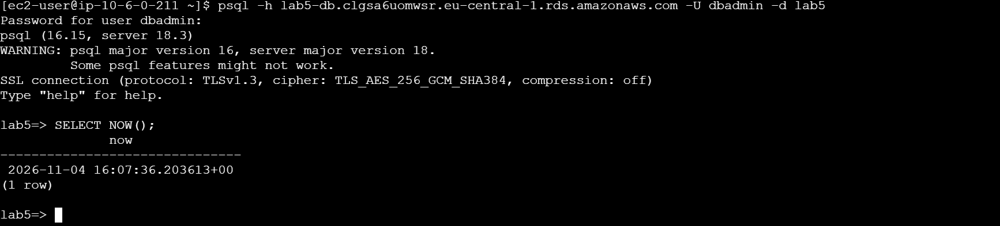

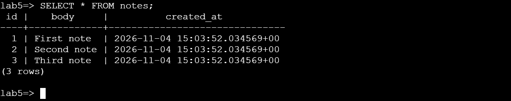

Через RDS запущено восстановление на выбранный момент времени до удаления записей. Восстановление выполнялось в **отдельный экземпляр**, без перезаписи исходной базы.

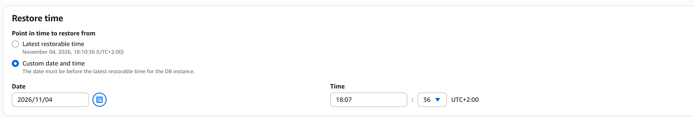

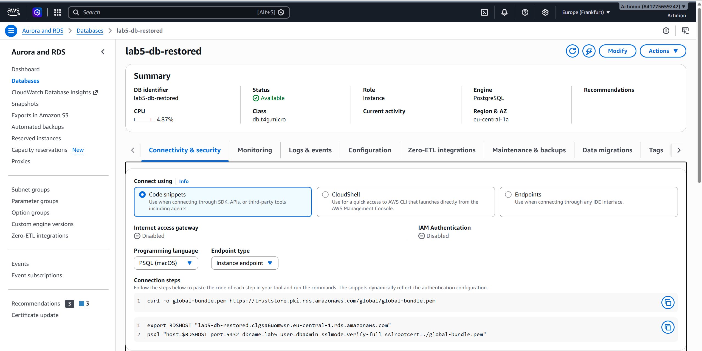

Проверка восстановленной базы показала наличие четырёх записей, существовавших до удаления. Это подтверждает возможность восстановить состояние базы на выбранный момент в пределах доступного окна восстановления.

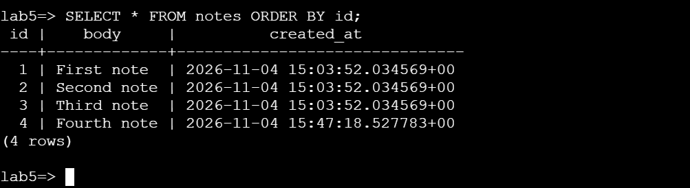

После завершения экспериментов дополнительные экземпляры Read Replica и PITR были удалены, чтобы не расходовать ресурсы аккаунта.

---

## Часть II. Миграция TimeCapsule на Amazon RDS

### Задание 6. Подготовка управляемой базы для приложения

TimeCapsule — веб-приложение, использующее PHP и PostgreSQL. До миграции база данных работала на отдельном EC2-сервере `timecapsule-dev-db` в приватной подсети. Для новой архитектуры использован существующий приватный RDS `lab5-db` в той же VPC. Внутри RDS подготовлена база `timecapsule_db` и пользователь `timecapsule_user`, которому предоставлены необходимые права для работы приложения.

В задании предлагались отдельные имена ресурсов `timecapsule-dev-rds` и `timecapsule-dev-db-subnets`. В данной реализации сохранены `lab5-db` и `lab5-db-subnets`, поскольку создание дополнительного экземпляра ограничивалось условиями Free Plan.

### Задание 7. Автоматическая остановка через EventBridge Scheduler

Создано расписание `timecapsule-dev-rds-nightly-stop` в группе `default`:

| Параметр | Значение |
|---|---|
| Тип расписания | Cron |
| Выражение | `cron(0 23 * * ? *)` |
| Часовой пояс | `Europe/Chisinau` |
| Flexible time window | Off |
| Целевая операция | Amazon RDS `StopDBInstance` |
| Идентификатор базы | `lab5-db` |
| IAM-роль | `timecapsule-dev-scheduler-role` |
| Состояние | Enabled |

Роль имеет доверительную политику для сервиса `scheduler.amazonaws.com` и ограниченное разрешение `rds:StopDBInstance` на ARN конкретной базы `lab5-db` (принцип минимально необходимых привилегий).

**Ограничение проверки:** расписание было создано и включено, но его автоматическое срабатывание не тестировалось. Проверка ручной остановки RDS выполнена отдельно в задании 11. Поскольку расписание только останавливает RDS, для последующего использования приложения базу необходимо запускать вручную или предусмотреть отдельный механизм запуска.

### Задание 8. Подготовка базы и пользователя

В RDS подготовлена рабочая база `timecapsule_db` и отдельный пользователь приложения `timecapsule_user`. Права пользователя настроены для операций с таблицами и последовательностями приложения. Административный пользователь RDS (`dbadmin`) использовался для задач настройки и восстановления данных.

Имена отличаются от рекомендованных в задании (`timecapsule` для базы и пользователя), но приложение успешно работает с выбранными именами.

### Задание 9. Перенос данных с EC2 на RDS

На исходном EC2-сервере проверена структура PostgreSQL и количество записей в основных таблицах TimeCapsule:

| Таблица | Количество до миграции |
|---|---:|
| `users` | 2 |
| `capsules` | 5 |
| `notifications` | 10 |

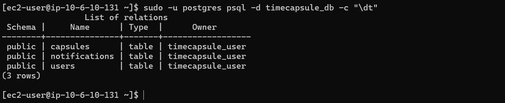

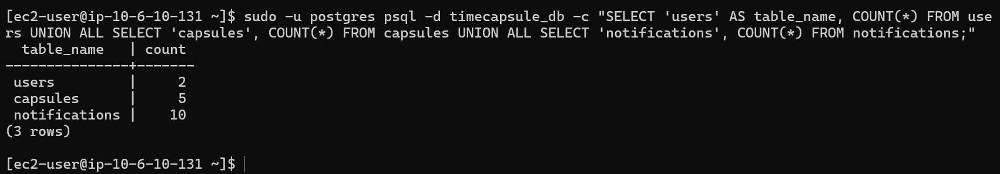

Для переноса использован `pg_dump` в custom-формате, а для восстановления — `pg_restore`. Такой формат позволяет восстановить структуру и данные базы с помощью стандартных инструментов PostgreSQL.

Пример применённого подхода (имена подключения и пароли намеренно не раскрываются):

```bash
pg_dump -Fc -d <SOURCE_DATABASE> -f /tmp/timecapsule_backup.dump
pg_restore --no-owner -h <RDS_ENDPOINT> -U dbadmin -d timecapsule_db /tmp/timecapsule_backup.dump
```

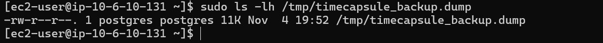

После восстановления проверены таблицы и записи на RDS. Сопоставление с исходными данными подтвердило успешную миграцию.

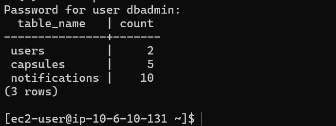

### Задание 10. Переключение приложения на RDS и Route 53

В приватной зоне Amazon Route 53 `timecapsule.internal` запись `db.timecapsule.internal` была изменена на **CNAME**, указывающий на endpoint RDS:

```text
db.timecapsule.internal
    CNAME -> lab5-db.clgsa6uomwsr.eu-central-1.rds.amazonaws.com
```

В конфигурации TimeCapsule (`/var/www/timecapsule/.env`) установлен `DB_HOST=db.timecapsule.internal`; также указаны имя базы `timecapsule_db` и пользователь `timecapsule_user`. Подключение PHP/PDO настроено с обязательным SSL/TLS (`sslmode=require`).

Разрешение приватного имени проверено с EC2-сервера приложения: DNS возвращал адрес RDS внутри VPC. Подключение `psql` и работа приложения подтвердили доступность новой базы.

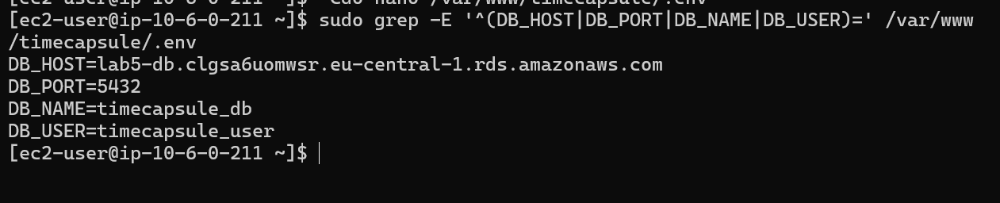

Через веб-интерфейс TimeCapsule созданы новые записи. Проверка PostgreSQL подтвердила запись данных в RDS: количество капсул увеличилось с пяти до семи.

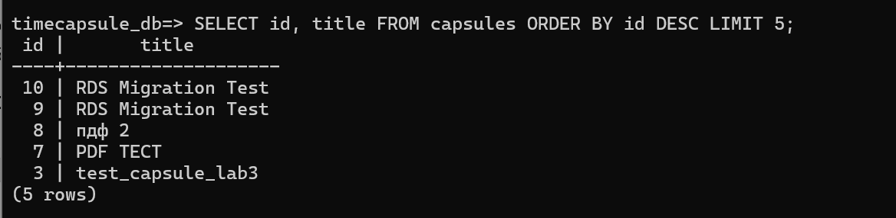

Затем старый сервер PostgreSQL на EC2 был **остановлен**. Несмотря на это, TimeCapsule продолжил работать, что подтверждает переключение приложения на Amazon RDS.

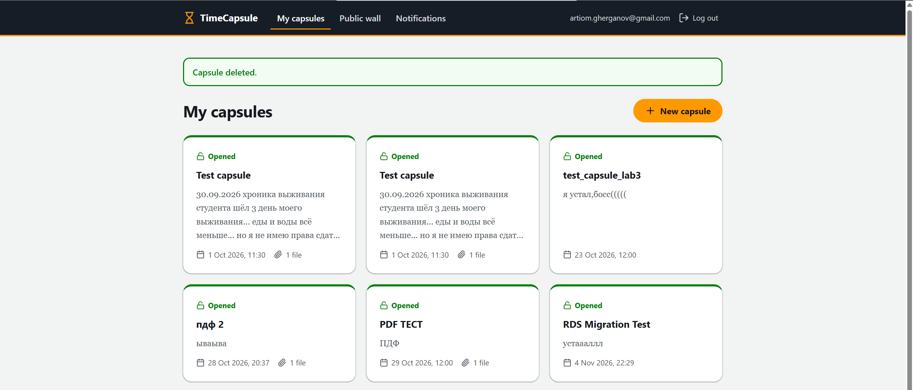

**Не завершено в рамках данного шага:** старый EC2-сервер ещё не переведён в состояние Terminated; он оставлен остановленным, в том числе до окончательного решения о сохранении резервной копии. Отдельная проверка URL `/health` в предоставленных материалах не подтверждена; доступность проверялась через веб-интерфейс и SQL-запросы.

### Задание 11. Проверка отказоустойчивости и журналов

**Эксперимент 1 — Reboot RDS.** До перезагрузки TimeCapsule работал. Во время `RebootDBInstance` приложение временно потеряло соединение с PostgreSQL и отобразило HTTP 500 с сообщением о невозможности подключения к базе данных.

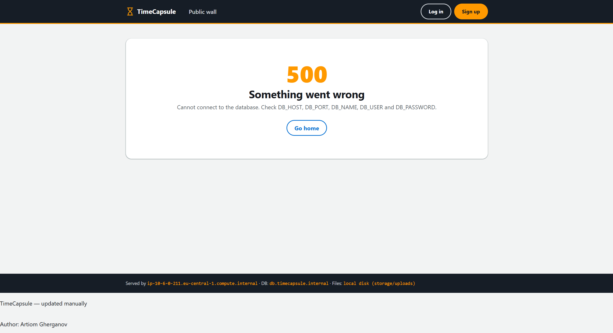

После перехода RDS в статус `Available` веб-интерфейс и страница Public wall вновь стали доступны.

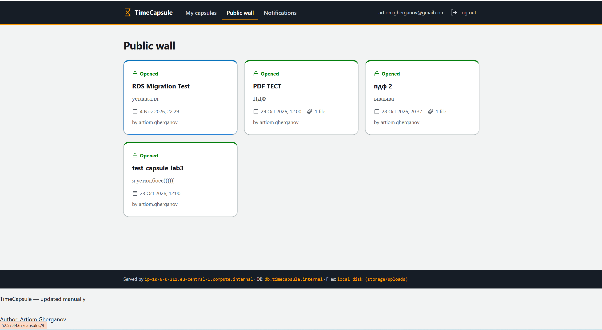

В разделе **RDS → Logs & events** обнаружены события `DB instance shutdown` и `DB instance restarted` от 04.11.2026, 23:47 (UTC+02:00).

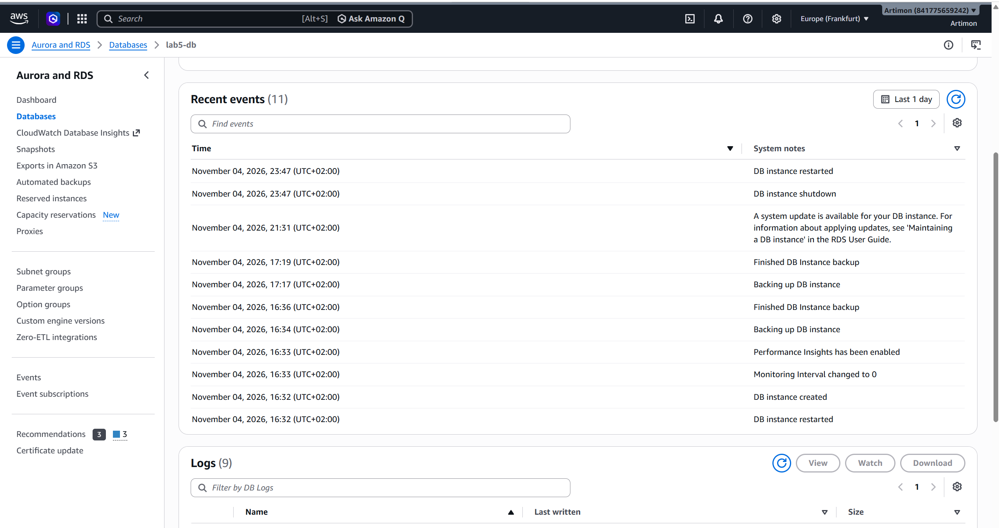

В AWS CloudTrail зарегистрирована операция `RebootDBInstance` для `lab5-db`, выполненная 04.11.2026 в 23:47:36 (UTC+02:00). В подробностях события поле Error code не содержало ошибки.

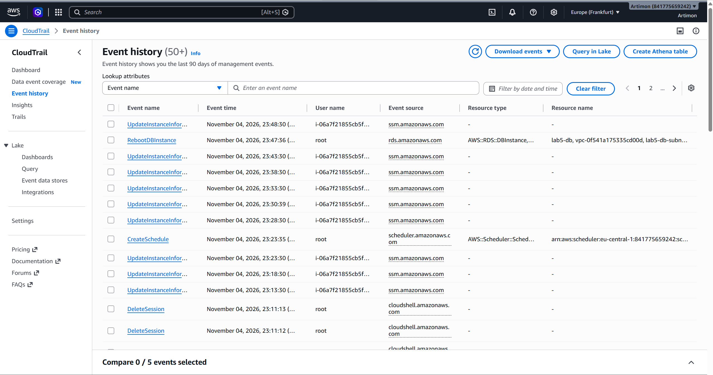

**Эксперимент 2 — Stop temporarily / Start.** RDS был временно остановлен вручную. При остановленной базе сайт повторно показал ошибку HTTP 500 из-за недоступности PostgreSQL.


После ручного запуска RDS и возвращения в состояние `Available` сайт и данные снова стали доступны. В CloudTrail найдено событие `StopDBInstance`, подтверждающее регистрацию действия.

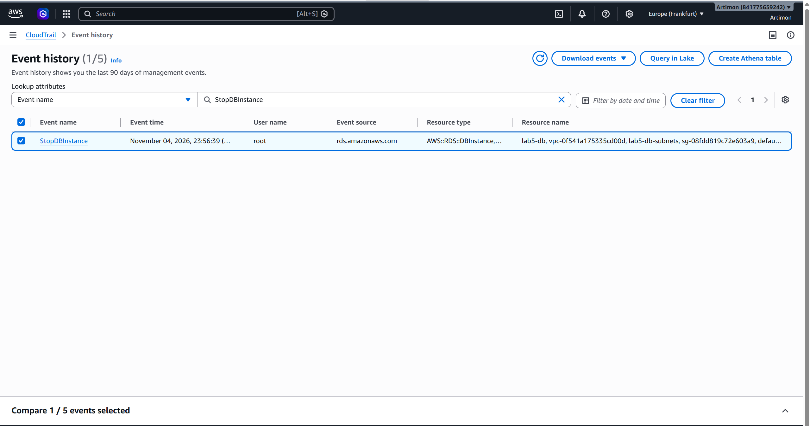

**Вывод по отказоустойчивости:** приложение восстанавливает работу после возобновления доступности RDS, но во время остановки и перезагрузки базы показывает ошибку 500. Развёртывание Single-AZ не обеспечивает автоматический переход на резервную AZ. Для промышленной системы можно рассмотреть Multi-AZ, обработку ошибок подключения и механизмы повторных попыток.

### Задание 12. Архитектурное решение и документация

В проекте подготовлен ADR `docs/adr/0004-database-hosting.md`, описывающий выбор Amazon RDS Single-AZ вместо PostgreSQL на EC2, RDS Multi-AZ и Aurora PostgreSQL. В ADR рассмотрены управляемость, стоимость, резервное копирование, RPO/RTO, ограничения Single-AZ и автоматическая остановка.


---

## Итоги и соответствие заданиям

| № | Результат | Статус |
|---:|---|---|
| 1 | DB Subnet Group и приватные подсети | Выполнено |
| 2 | RDS PostgreSQL и Security Group | Выполнено; backup retention 1 день из-за Free Plan |
| 3 | Подключение и SQL-операции | Выполнено |
| 4 | Read Replica и ReplicaLag | Выполнено |
| 5 | PITR и проверка восстановленных данных | Выполнено |
| 6 | RDS для TimeCapsule | Выполнено с отличающимися именами ресурсов |
| 7 | EventBridge Scheduler и IAM | Настроено; автоматическое срабатывание не проверено |
| 8 | База и пользователь приложения | Выполнено с отличающимися именами |
| 9 | `pg_dump` / `pg_restore`, проверка данных | Выполнено |
| 10 | Route 53, переключение приложения, старый EC2 | Частично: старый EC2 остановлен, но не удалён; `/health` отдельно не проверен |
| 11 | Reboot, Stop/Start, события RDS и CloudTrail | Выполнено |
| 12 | ADR, отчёт, архитектура | ADR и отчёт подготовлены; графическая схема требует обновления |

## Общий вывод

В ходе лабораторной работы изучены основные возможности Amazon RDS for PostgreSQL: создание приватной базы, управление доступом, подключение по TLS, Read Replica, метрика ReplicaLag, резервное копирование и PITR. Проведена миграция действующего приложения TimeCapsule с самостоятельного PostgreSQL на EC2 на управляемый Amazon RDS. Проверены целостность перенесённых данных, запись новых объектов и работа приложения после остановки старого сервера БД.

Также настроена приватная DNS-запись Route 53 и расписание EventBridge Scheduler с IAM-ролью минимальных привилегий. Эксперименты с перезагрузкой и временной остановкой RDS показали зависимость приложения от доступности PostgreSQL и успешное восстановление после запуска базы. AWS CloudTrail подтвердил регистрацию управляющих API-операций.

Ограничения реализации: использование Single-AZ, однодневное хранение автоматических резервных копий из-за AWS Free Plan, отсутствие теста фактического срабатывания расписания, не завершённое удаление старого EC2 и необходимость обновить графическую архитектурную схему. Эти ограничения не скрываются и должны учитываться при оценке результатов и дальнейшей эксплуатации проекта.

## Контрольные вопросы и ответы на них


### 1. Как проходит запрос от браузера до базы?

Браузер отправляет запрос на EC2-сервер, где работает TimeCapsule. Сервер через Route 53 находит адрес Amazon RDS и подключается к PostgreSQL. На каждом этапе проверяются сетевые разрешения, а база дополнительно проверяет логин, пароль и права пользователя. После этого данные возвращаются приложению и отображаются в браузере.

### 2. Чем репликация отличается от резервного копирования?

**Репликация** — это постоянное копирование изменений из основной базы в другую. Она помогает распределять нагрузку, но копирует и ошибочные изменения.

**Резервное копирование** — это сохранение данных для последующего восстановления, например после случайного удаления таблицы.

**Главное отличие:** репликация поддерживает актуальную копию данных, а резервное копирование позволяет восстановить их прежнее состояние.

### 3. Как пережить отказ зоны eu-central-1a и сколько это будет стоить?

Для этого используется **Amazon RDS Multi-AZ**. AWS размещает резервную базу в другой зоне доступности и автоматически переключается на неё при отказе основной.

Это повышает отказоустойчивость, но стоит дороже — для классического Multi-AZ примерно вдвое по сравнению с Single-AZ. В нашей лабораторной используется Single-AZ ради экономии.

### 4. Как решили проблему автоматического запуска базы через 7 дней?

AWS автоматически запускает остановленную RDS через 7 дней. Мы настроили **EventBridge Scheduler** для ежедневной остановки базы в 23:00.

Однако это не отменяет семидневное ограничение. Для полноценного решения нужно дополнительно настроить автоматический запуск базы, например утром, и повторную остановку вечером.

В нашей лабораторной реализована только автоматическая остановка.

---


