# Лабораторная работа №6 — Application Load Balancing и Auto Scaling в AWS

**Дисциплина:** Cloud Computing  
**Студент:** Герганов Артём  
**Группа:** IA2404  


## 1. Цель работы

Изучить распределение HTTP-трафика между несколькими EC2 с помощью Application Load Balancer (ALB), автоматическое масштабирование через Auto Scaling Group (ASG), мониторинг CloudWatch и создание отказоустойчивой архитектуры приложения TimeCapsule. Обеспечить сохранение PHP-сессий при переключении между серверами, используя Amazon DynamoDB.

## 2. Используемые технологии

| Сервис / технология | Назначение |
|---|---|
| Amazon EC2 (`t3.micro`) | Запуск PHP-приложения |
| Application Load Balancer | Распределение HTTP-запросов |
| Target Group и health checks | Маршрутизация только на работоспособные EC2 |
| Auto Scaling Group | Изменение количества EC2 в зависимости от нагрузки |
| Amazon CloudWatch | Метрики, сигналы тревоги, масштабирование |
| Amazon RDS for PostgreSQL | Основные данные TimeCapsule |
| Amazon DynamoDB | Централизованное хранение PHP-сессий |
| Amazon S3 | Хранение файлов приложения |
| AWS IAM | Доступ EC2 к AWS-сервисам по ролям |
| AWS SDK for PHP | Интеграция PHP с DynamoDB |
| PowerShell | Генерация тестовой HTTP-нагрузки |

## 3. Часть I. Базовая конфигурация ALB и Auto Scaling

### 3.1. Подготовка инфраструктуры

В первой части были созданы тестовые ресурсы с префиксом `lab6-*`: группа безопасности балансировщика, Application Load Balancer, Target Group, Launch Template и Auto Scaling Group. Балансировщик принимал HTTP-запросы, а целевая группа использовалась для регистрации и проверки EC2. Настройки сетевого доступа разрешали HTTP-трафик к балансировщику и доступ балансировщика к целевым экземплярам.

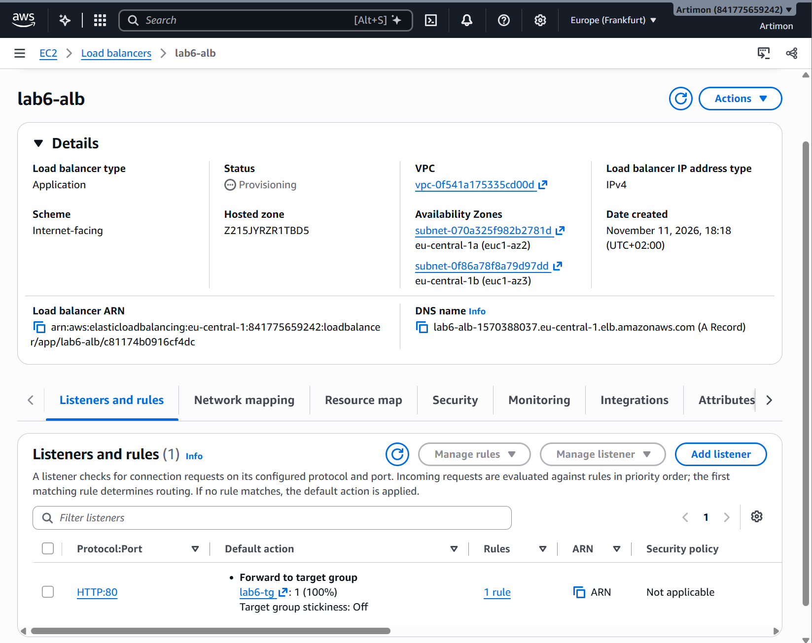

*Рисунок 1 — Создание тестового Application Load Balancer.*

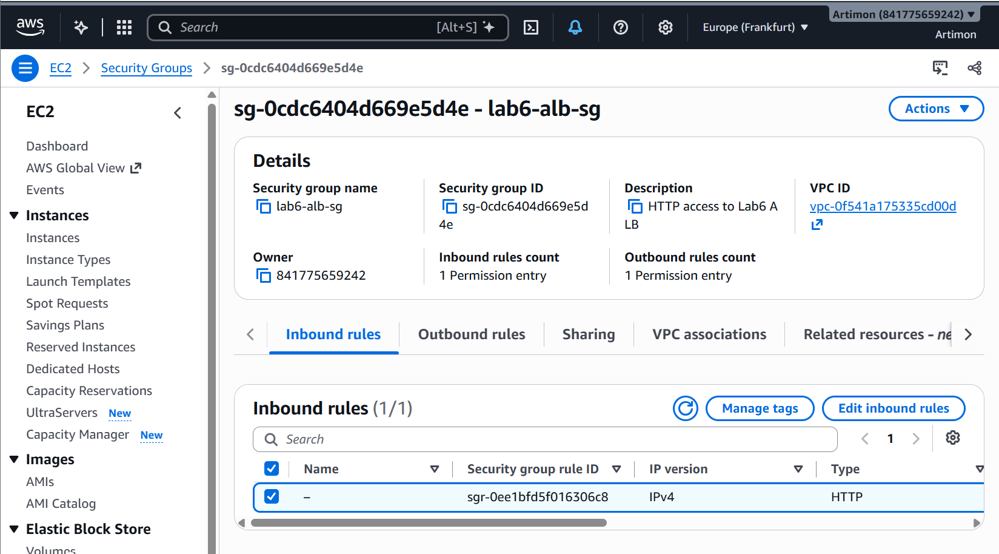

*Рисунок 2 — Правила доступа к тестовому ALB.*

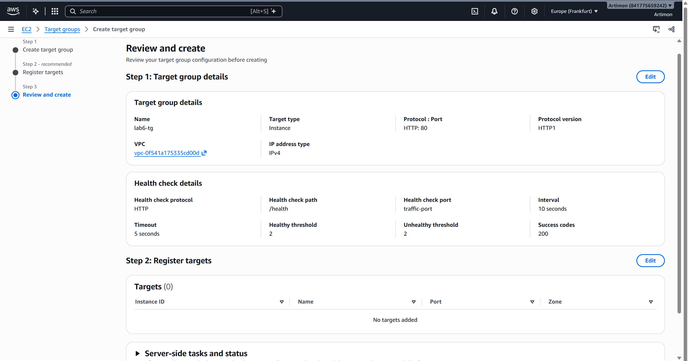

*Рисунок 3 — Параметры целевой группы.*

### 3.2. Launch Template и Auto Scaling Group

Launch Template определял параметры запуска EC2. Auto Scaling Group использовала шаблон для поддержания необходимого количества серверов и их автоматического запуска или удаления.

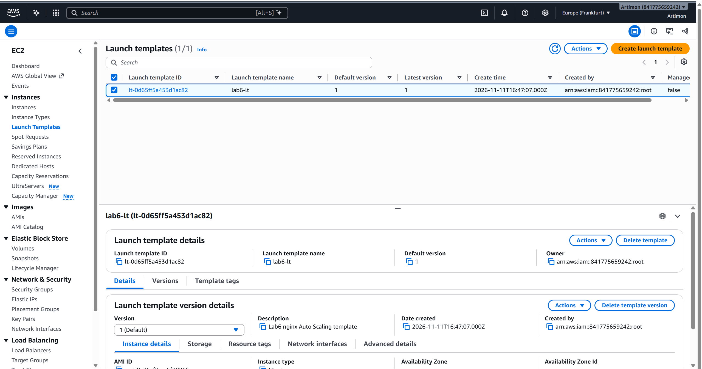

*Рисунок 4 — Созданный шаблон запуска.*

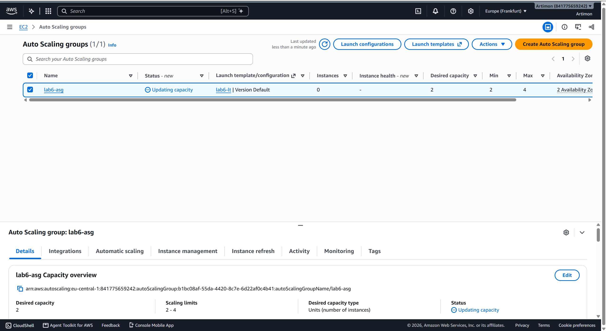

*Рисунок 5 — Созданная группа автоматического масштабирования.*

### 3.3. Проверка балансировки и состояния целей

Через Target Group проверялось состояние зарегистрированных серверов. При доступности нескольких здоровых экземпляров ALB мог распределять запросы между ними. В ходе настройки также фиксировался ответ `503 Service Temporarily Unavailable`: такой ответ возможен, когда балансировщик не располагает доступными здоровыми целями. После корректной настройки целевых экземпляров их статус стал `Healthy`.


*Рисунок 6 — Пример ошибки 503 на промежуточном этапе настройки.*

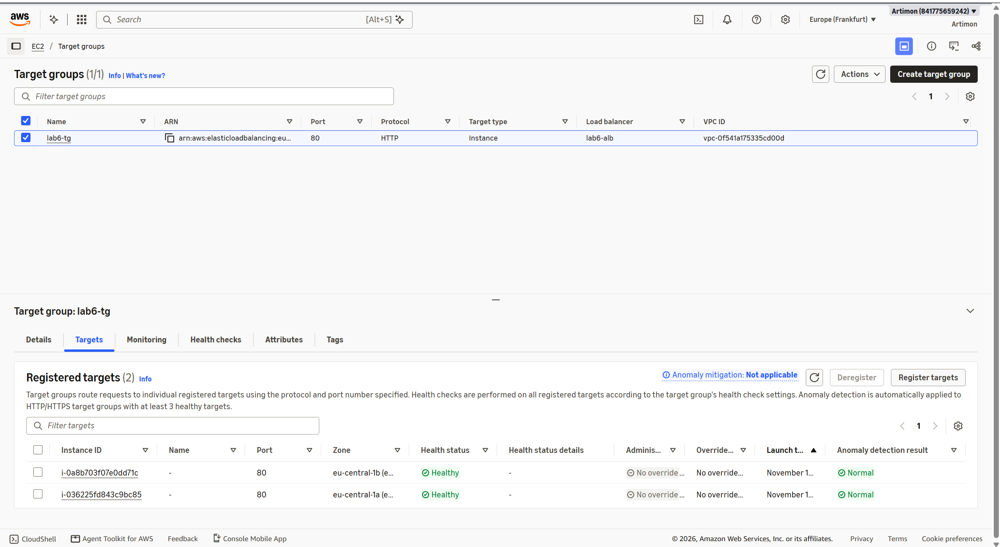

*Рисунок 7 — Здоровые экземпляры в Target Group.*

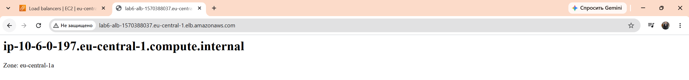

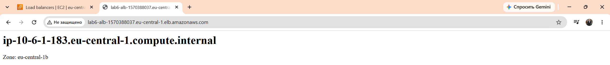

*Рисунки 8–9 — Проверка ответов от разных серверов через ALB.*

### 3.4. Проверка масштабирования

Для проверки автоматического масштабирования анализировались метрики CloudWatch и история активности ASG. Скриншоты показывают события увеличения и уменьшения числа экземпляров, а также итоговый состав группы.

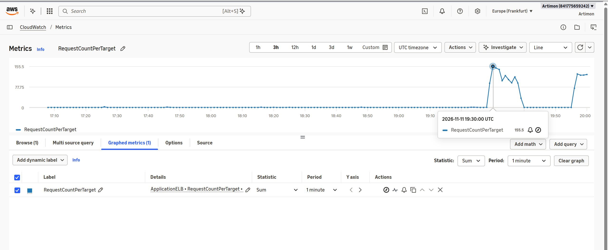

*Рисунок 10 — Метрика запросов CloudWatch.*

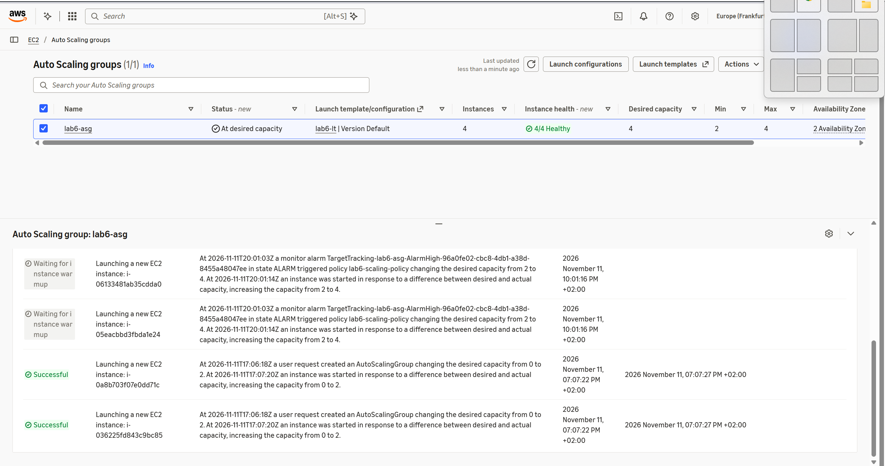

*Рисунок 11 — История Scale Out.*

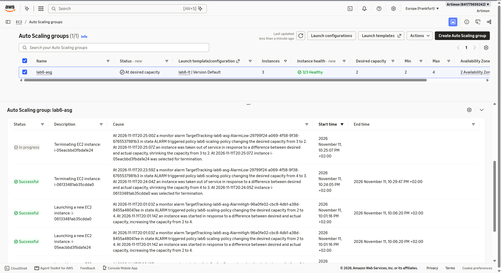

*Рисунок 12 — История Scale In.*

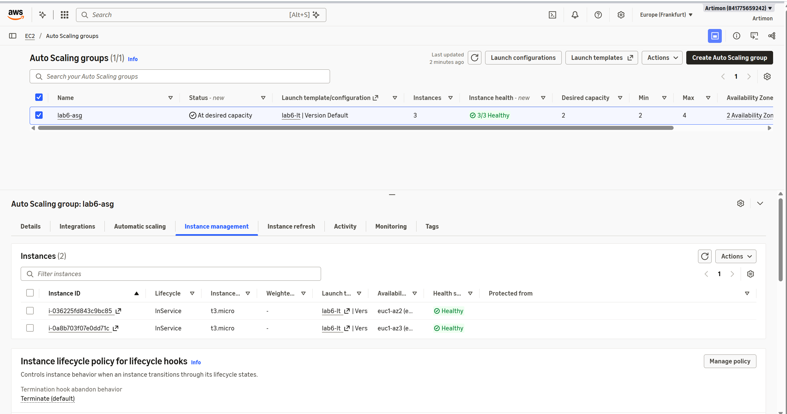

*Рисунок 13 — Итоговое состояние тестовой ASG.*

**Итог части I:** освоены настройка ALB, Target Group, Launch Template, ASG, health checks и мониторинг автоматического масштабирования. Тестовые ресурсы первой части были удалены после завершения проверки.

## 4. Часть II. Масштабируемое приложение TimeCapsule

### 4.1. Проблема хранения сессий

Изначально PHP-сессии могли храниться локально на EC2. При балансировке запросов между несколькими серверами это создаёт проблему: второй экземпляр не имеет доступа к файлу сессии первого, поэтому пользователь может потерять авторизацию. Для устранения проблемы выбрано общее хранилище Amazon DynamoDB.

### 4.2. DynamoDB для PHP-сессий

Создана таблица `timecapsule-dev-sessions`:

| Параметр | Значение |
|---|---|
| Partition key | `id` (String) |
| Режим оплаты | On-demand |
| TTL attribute | `expires` |
| Назначение | Сохранение данных PHP-сессии независимо от EC2 |

Для EC2 использована роль `timecapsule-dev-ec2-s3-role`, дополненная политикой `timecapsule-dev-app-sessions` с разрешениями `GetItem`, `PutItem`, `UpdateItem`, `DeleteItem` для таблицы сессий. В PHP перед `session_start()` подключён `Aws\DynamoDb\SessionHandler` из AWS SDK for PHP. В конфигурации приложения используется переменная `DYNAMODB_SESSION_TABLE=timecapsule-dev-sessions`.

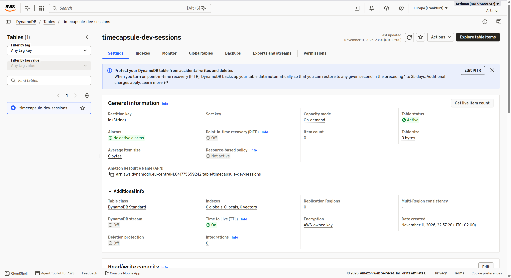

*Рисунок 14 — Включение TTL для таблицы сессий.*

После входа пользователя запись сессии появилась в DynamoDB, что подтвердило использование общего хранилища. **Скриншоты содержимого сессии следует обезличить перед публичной публикацией**, поскольку поле `data` может включать токены и другие служебные значения.

### 4.3. Создание AMI и Launch Template

После проверки приложения был создан образ AMI `timecapsule-dev-app-lab6` (`ami-0f46652262520ae96`). На его основе создан Launch Template `timecapsule-dev-app-lt` (`lt-0ea73c093d074f7e5`), версия 1:

- Тип EC2: `t3.micro`;
- Security Group: `timecapsule-dev-app-asg-sg`;
- IAM Role: `timecapsule-dev-ec2-s3-role`;
- IMDSv2: обязательный;
- образ содержит подготовленное PHP-приложение.

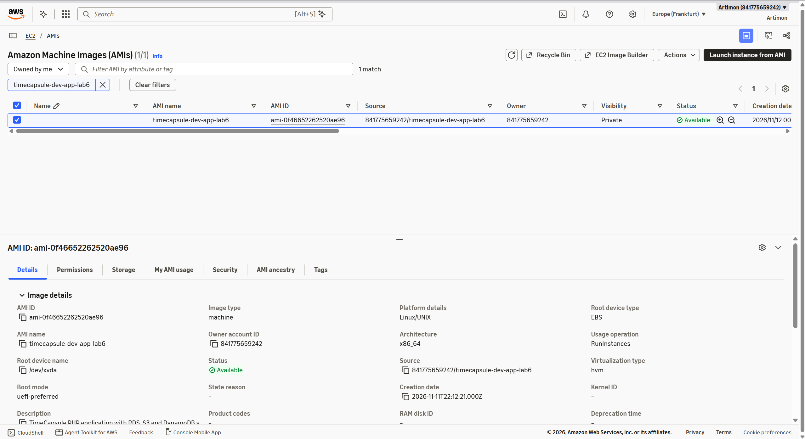

*Рисунок 15 — Созданный образ TimeCapsule.*

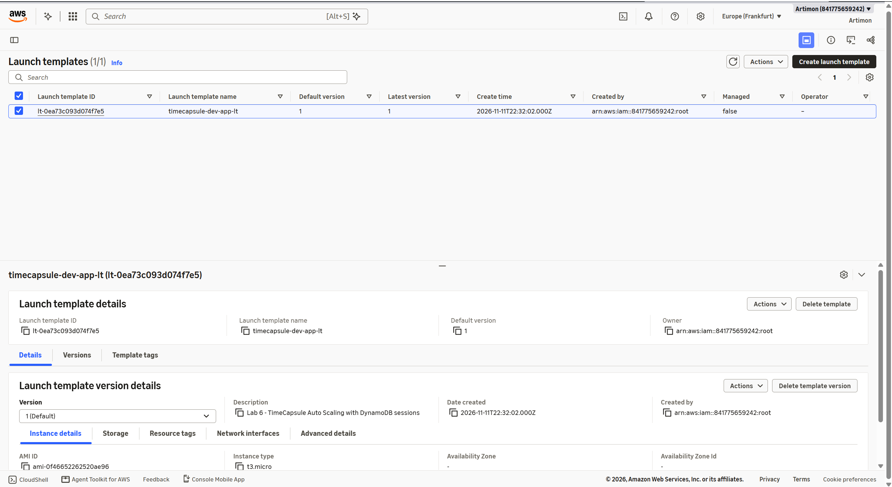

*Рисунок 16 — Шаблон запуска TimeCapsule.*

**Примечание по безопасности:** AMI был создан с уже настроенным приложением; конфиденциальные значения `.env` не следует публиковать. Для промышленной среды рекомендуется переносить секреты в AWS Secrets Manager или SSM Parameter Store.

### 4.4. Настройка Target Group, ALB и ASG

Создана целевая группа `timecapsule-dev-tg`, протокол HTTP, порт 80, проверка `/health`. Затем создан интернет-доступный ALB `timecapsule-dev-alb` с HTTP listener на порту 80 и передачей запросов в эту Target Group.

Адрес ALB во время лабораторной: `http://timecapsule-dev-alb-1653599946.eu-central-1.elb.amazonaws.com`.

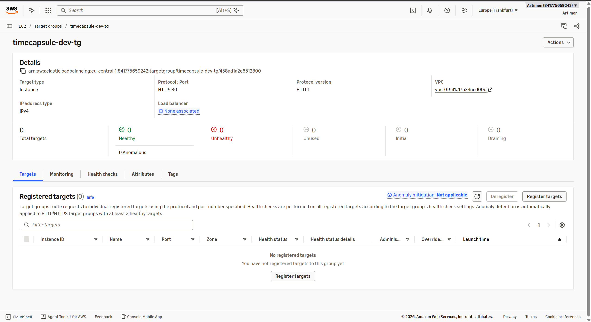

*Рисунок 17 — Целевая группа TimeCapsule.*

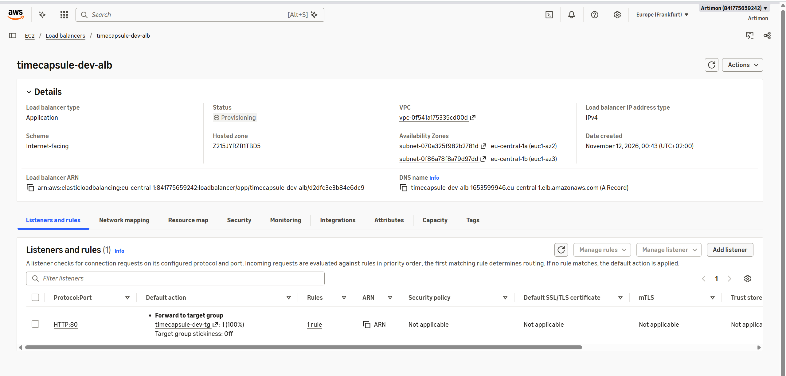

*Рисунок 18 — Созданный балансировщик TimeCapsule.*

Auto Scaling Group `timecapsule-dev-asg` использует две зоны доступности `eu-central-1a` и `eu-central-1b`. Параметры масштабирования:

| Параметр | Значение |
|---|---|
| Minimum capacity | 2 |
| Desired capacity (базовое) | 2 |
| Maximum capacity | 4 |
| Проверки состояния | EC2 + ELB |
| Health check grace period | 300 с |
| Default instance warmup | 300 с |
| Политика | Target tracking |
| Метрика | `ALBRequestCountPerTarget` |
| Целевое значение | 50 запросов на цель |

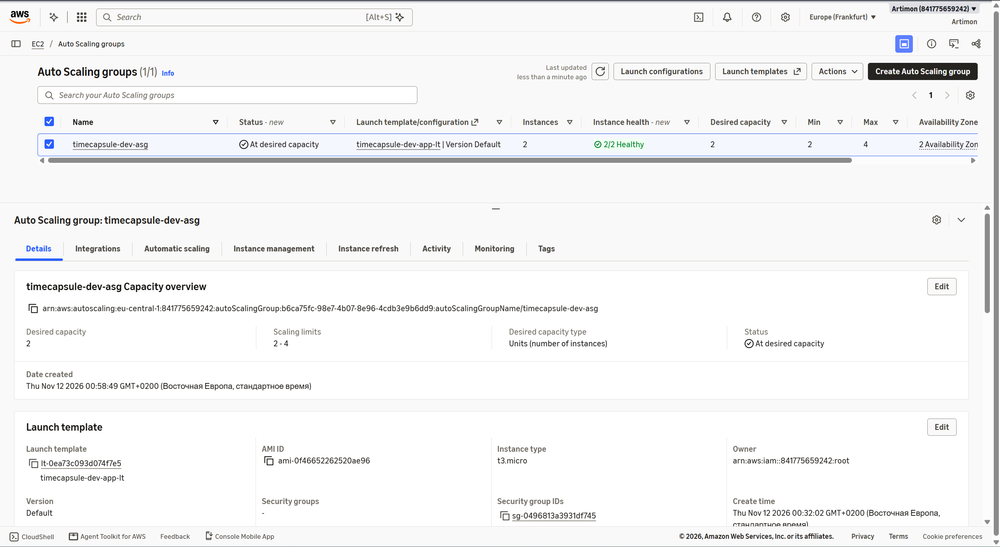

*Рисунок 19 — Созданная группа Auto Scaling TimeCapsule.*

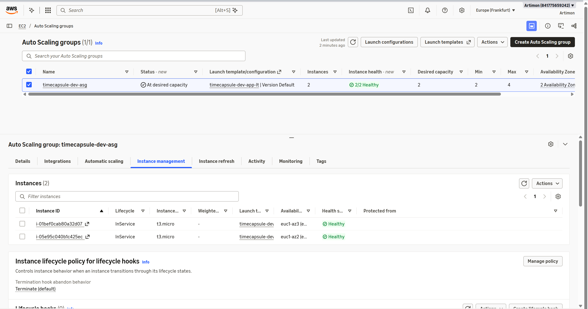

*Рисунок 20 — Экземпляры в составе ASG.*

### 4.5. Диагностика ошибок и проверка здоровья

На промежуточном этапе проверка `/health` возвращала ошибку `500` с признаком `db:error`. Причиной оказалось отсутствие разрешения на подключение новых EC2 к RDS. В Security Group базы `lab5-rds-sg` добавлено входящее правило PostgreSQL TCP 5432 **от Security Group серверов ASG**, без открытия базы всему интернету. После исправления новые экземпляры получили статус `Healthy`.

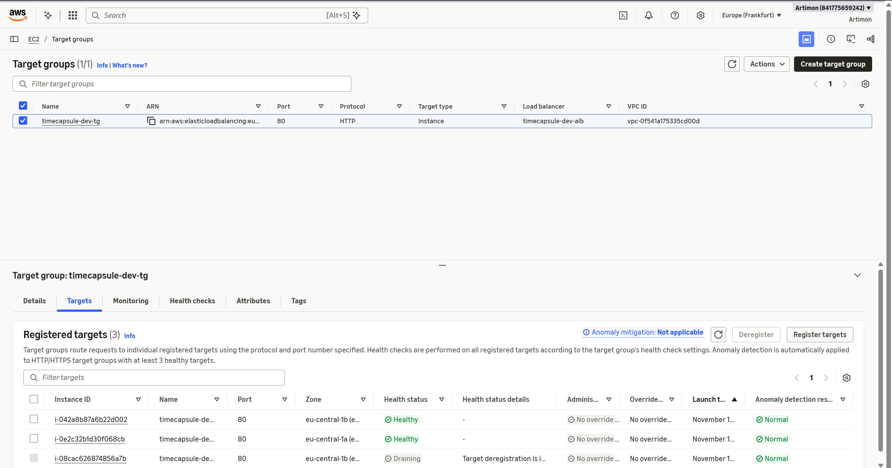

*Рисунок 21 — Здоровые цели TimeCapsule.*

### 4.6. Проверка балансировки и сохранения авторизации

Через ALB открывался `/health`. В ответах отображались разные имена EC2, что подтвердило распределение запросов между двумя серверами. Пользователь выполнил вход в приложение, затем многократно обновлял страницы через ALB; авторизация сохранилась благодаря общим сессиям в DynamoDB.

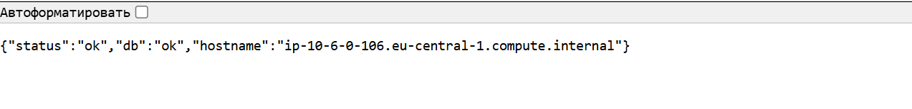

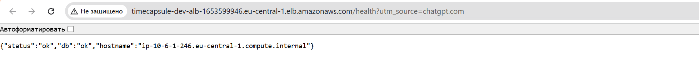

*Рисунки 22–23 — Ответы разных экземпляров TimeCapsule.*

### 4.7. Нагрузочный тест и Scale Out

Нагрузка генерировалась из PowerShell с помощью повторных запросов к `/health` в течение пяти минут:

```powershell
$url = "http://timecapsule-dev-alb-1653599946.eu-central-1.elb.amazonaws.com/health"
$end = (Get-Date).AddMinutes(5)
$count = 0
while ((Get-Date) -lt $end) {
    try {
        Invoke-WebRequest -Uri $url -UseBasicParsing -TimeoutSec 10 | Out-Null
        $count++
    }
    catch { Write-Host "Ошибка запроса: $($_.Exception.Message)" }
}
Write-Host "Всего успешных запросов: $count"
```

**Результат:** 2441 успешный запрос за пять минут (в среднем около 488 запросов в минуту). CloudWatch AlarmHigh с условием `RequestCountPerTarget > 50` в трёх минутных точках перешёл в `ALARM`. Политика масштабирования увеличила `Desired capacity` с **2 до 4**; два дополнительных EC2 успешно запущены.

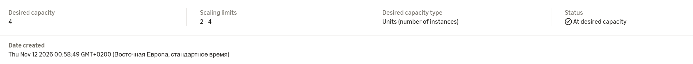

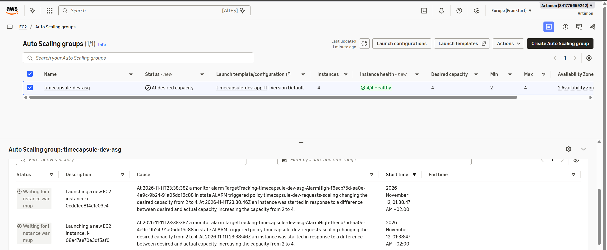

*Рисунки 24–25 — Увеличение мощности ASG и журнал запуска EC2.*

### 4.8. Scale In после уменьшения нагрузки

После прекращения теста AlarmLow зафиксировал длительную низкую нагрузку (условие `RequestCountPerTarget < 35` в течение 15 минут) и запустил обратное масштабирование. В Activity history подтверждены последовательные изменения `Desired capacity` **4 → 3 → 2**. Лишние экземпляры прошли этап `Connection draining`, затем были удалены.

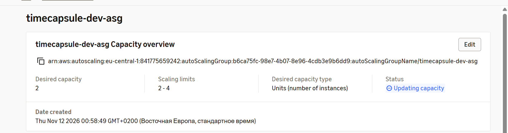

*Рисунок 26 — Desired capacity вернулся к двум экземплярам.*

Финальная проверка показала два экземпляра со статусами **InService / Healthy** в разных Availability Zones. Сайт продолжил открываться, вход в аккаунт и сохранение авторизации работали.

### 4.9. Отключение исходного сервера

После подтверждения работоспособности ALB и ASG исходный сервер `timecapsule-dev-app-server` (`i-06a7f21855cb5f457`) был **остановлен**, а его Elastic IP `52.57.44.67` — отвязан и освобождён. Таким образом, приложение перестало зависеть от первоначального одиночного EC2.

## 5. Архитектура решения


Взаимодействие с RDS, S3 и DynamoDB выполняет PHP-приложение на EC2. Браузер не обращается к этим сервисам напрямую. Для запросов к AWS-сервисам применяются IAM-разрешения, а доступ к PostgreSQL ограничивается Security Groups.

## 6. ADR-0005 — Выбор хранилища сессий

**Статус:** Accepted. **Решение:** хранить PHP-сессии в DynamoDB.

| Критерий | Sticky Sessions (ALB) | PostgreSQL RDS | DynamoDB |
|---|---|---|---|
| Общее хранилище сессий | Нет, при локальных PHP-файлах | Да | Да |
| Устойчивость к замене EC2 | Слабая | Хорошая | Хорошая |
| Нагрузка на основную БД | Нет | Дополнительная | Нет |
| Управление инфраструктурой | Минимальное | Требует схемы и обслуживания | Управляемый сервис |
| Удаление просроченных записей | На стороне EC2 | Нужно реализовать | TTL |

**Обоснование:** Sticky Sessions не решают проблему потери локальной сессии при завершении EC2. PostgreSQL позволяет хранить сессии централизованно, но увеличивает нагрузку на основную базу. DynamoDB обеспечивает отдельное масштабируемое хранилище, TTL и IAM-контроль. Цена выбора — зависимость от DynamoDB, дополнительные запросы и необходимость SDK.

**Проверка:** авторизация сохранилась при распределении запросов через ALB и после Scale Out / Scale In. Полная версия ADR хранится в `docs/adr/0005-session-storage.md` проекта.

## 7. Ответы на контрольные вопросы

### 7.1. Как проходит запрос от браузера до базы и таблицы сессий?

1. Пользователь открывает DNS-адрес ALB в браузере и отправляет HTTP-запрос.
2. ALB выбирает один из здоровых EC2, зарегистрированных в Target Group.
3. На выбранном EC2 веб-сервер передаёт запрос PHP-приложению TimeCapsule.
4. PHP получает идентификатор сессии из cookie браузера. Обработчик `Aws\DynamoDb\SessionHandler` читает соответствующую запись из таблицы `timecapsule-dev-sessions` через AWS SDK, используя IAM Role EC2. При необходимости обновляет сессию.
5. Если операция требует данных приложения, PHP подключается к Amazon RDS PostgreSQL по TCP 5432 и выполняет SQL-запросы. Для файлов используются операции с S3.
6. PHP формирует ответ, EC2 возвращает его через ALB в браузер.

**Важно:** RDS хранит данные приложения, а DynamoDB — данные пользовательской сессии. Они используются параллельно и не образуют обязательную последовательность «RDS → DynamoDB». При переключении запроса на другой EC2 сессия остаётся доступной.

### 7.2. Чем проверка балансировщика отличается от проверки группы Auto Scaling?

**Проверка ALB / Target Group** определяет, может ли конкретный экземпляр корректно обслуживать запросы. В нашей работе Target Group обращается к `/health`; если сервер отвечает успешно, он считается здоровой целью и может получать трафик. Нездоровые цели ALB исключает из обычной маршрутизации при наличии здоровых целей.

**Проверка ASG** определяет, должен ли экземпляр продолжать существовать в группе. ASG использует проверки EC2 и, при включённом типе `ELB`, результаты health checks балансировщика. Если экземпляр признан нездоровым, ASG может завершить его и создать замену, чтобы поддержать Desired capacity. Отдельно политики масштабирования анализируют метрики CloudWatch и меняют само Desired capacity.

Иными словами, **ALB решает, куда отправить запрос**, а **ASG — сколько серверов должно работать и какие нужно заменить**. Проверки здоровья и метрики масштабирования — разные механизмы.

### 7.3. Что произойдёт при отказе зоны `eu-central-1a`?

При отказе зоны `eu-central-1a` экземпляр TimeCapsule в этой зоне станет недоступен. Target Group перестанет считать его здоровой целью, и ALB будет направлять запросы на оставшийся здоровый экземпляр в `eu-central-1b`. ASG обнаружит потерю мощности и попытается восстановить нужное число EC2 в доступных зонах согласно конфигурации группы и наличию ресурсов.

Поскольку PHP-сессии хранятся в региональном DynamoDB, а не на локальном диске отказавшего EC2, пользователи смогут продолжать работу с сессиями через оставшийся сервер, **при условии доступности DynamoDB и остальных зависимостей**. При этом возможны временное снижение производительности и ошибки во время переключения.

**Важное ограничение:** сохранение работоспособности всего приложения зависит также от размещения и доступности RDS, S3, сетевых компонентов и конфигурации базы. Наличие двух EC2 в разных зонах само по себе **не гарантирует**, что PostgreSQL переживёт отказ AZ; для базы требуется соответствующая отказоустойчивая конфигурация (например, RDS Multi-AZ). В этой лабораторной отказ целой зоны практически не моделировался — это прогноз на основе архитектуры.

## 8. Результаты и выводы

| Проверка | Результат |
|---|---|
| ALB распределяет запросы между EC2 | Подтверждено ответами разных серверов |
| `/health` и Target Group | Здоровые цели после исправления доступа к RDS |
| Общие PHP-сессии DynamoDB | Подтверждена запись сессии и сохранение входа |
| Автоматический Scale Out | 2 → 4 EC2 |
| Автоматический Scale In | 4 → 3 → 2 EC2 |
| HTTP-нагрузка | 2441 успешный запрос / 5 минут |
| Работа сайта после Scale In | Подтверждена |
| Исходный EC2 и Elastic IP | EC2 остановлен, Elastic IP освобождён |

**Вывод:** лабораторная продемонстрировала горизонтальное масштабирование TimeCapsule в AWS. ALB распределял трафик, ASG автоматически изменяла количество EC2, а DynamoDB устранила зависимость авторизации от отдельного сервера. Были изучены диагностические проверки `/health`, ограничения Security Groups, работа CloudWatch Alarms и безопасный переход от одиночного EC2 к масштабируемой архитектуре.


