# Лабораторная работа №7 — Бессерверные вычисления и события. AWS Lambda, Amazon SQS, Amazon SNS

**Дисциплина:** Cloud Computing  
**Студент:** Герганов Артём  
**Группа:** IA2404  
**Специальность:** Прикладная информатика  
**Уровень:** продвинутый (задания 1–10)  
**Регион:** eu-central-1 (Frankfurt)  
**Репозиторий:** https://github.com/Artimon4ik-cloud/timecapsule
## 1. Цель работы

Изучить событийное взаимодействие через SNS, SQS и Lambda. В первой части создать систему обработки отзывов, во второй — перенести создание уведомлений и автоматическое открытие капсул TimeCapsule из веб-запросов в фоновые функции. Проверить повторную доставку, восстановление после сбоя и защиту от дублирования.

## 2. Используемые технологии

| Сервис | Назначение |
|---|---|
| Amazon SNS | Распространение событий подписчикам |
| Amazon SQS Standard | Хранение сообщений до обработки |
| DLQ | Изоляция сообщений, которые не удалось обработать |
| AWS Lambda, Python | Обработка отзывов, уведомлений и открытие капсул |
| EventBridge Scheduler | Запуск Opener каждую минуту |
| CloudWatch Logs | Диагностика вызовов и ошибок |
| RDS PostgreSQL, pg8000 | Данные приложения и уведомления, TLS-подключение |
| IAM, VPC, Security Groups | Права и сетевой доступ |
| EC2, ALB, ASG, AWS SDK for PHP | Веб-приложение и публикация событий |

## 3. Часть I. Система отзывов

### 3.1. Задание 1. Тема и очередь

Созданы стандартная тема `lab7-reviews`, очередь `lab7-reviews-queue` и `lab7-reviews-dlq`. Очередь подписана на тему; политика доступа разрешает SNS отправлять сообщения. Отзывы публиковались через AWS CLI с JSON-телом и числовым атрибутом `rating`.

| Параметр | Значение | Обоснование |
|---|---|---|
| Visibility timeout | 60 с | В шесть раз больше таймаута Worker (10 с) |
| Retention | 4 дня | Запас времени на восстановление |
| Delivery delay | 0 с | Немедленная доступность |
| Receive wait time | 20 с | Long polling уменьшает пустые запросы |
| Maximum receives | 5 | Повторные попытки перед DLQ |

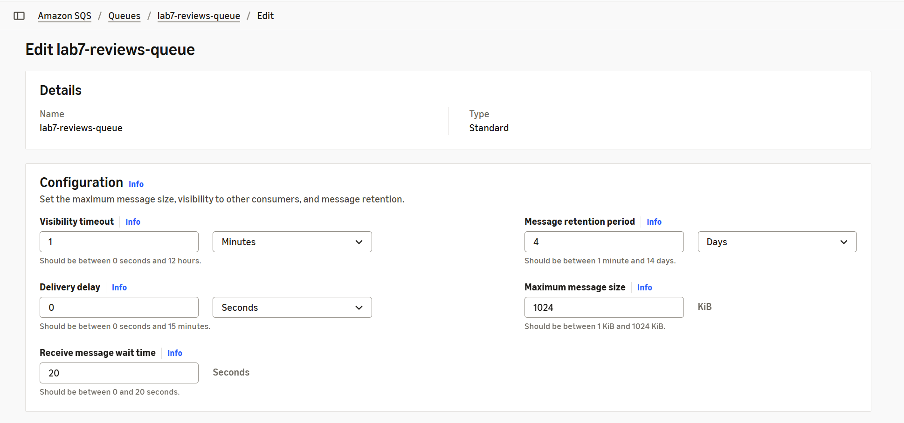

*Рисунок 1 — Конфигурация очереди отзывов.*

Без Raw message delivery SQS получает оболочку SNS с полями `Type`, `Message`, `TopicArn` и другими метаданными; исходный JSON находится внутри `Message`. При включении Raw message delivery тело содержит непосредственно JSON отзыва, поэтому обработчику не нужно разбирать дополнительную оболочку. Получение сообщения через Poll не удаляет его: после истечения visibility timeout оно снова доступно, если не было удалено.

### 3.2. Задание 2. Обработчик отзывов

Создана функция `lab7-review-worker` на Python с памятью 128 МБ и таймаутом 10 секунд. SQS подключена как источник событий; служба Lambda получает записи и передаёт их обработчику. Обработчик читает `record['body']`, разбирает JSON и выводит ID, оценку и первые 20 символов текста.

```python
# Фрагмент логики обработчика
review = json.loads(record['body'])
print(f"{review['id']}: {review['rating']}/5 {review['text'][:20]}")
```

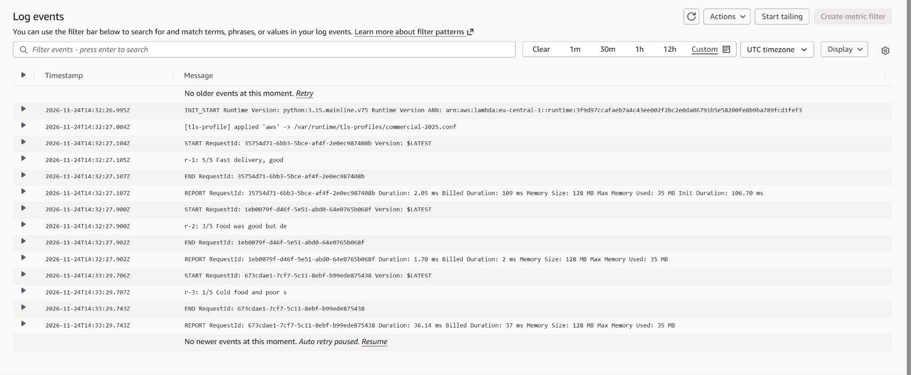

*Рисунок 2 — Три отдельных вызова для r-1, r-2 и r-3.*

В журнале видны три START с разными RequestId, то есть три вызова. Количество зависит от размера пачки, окна накопления и момента поступления сообщений; размер пачки на приложенных скриншотах не раскрыт. Таймаут 10 секунд достаточен для короткой операции журналирования.

### 3.3. Задание 3. Ошибка обработки и DLQ

Отправлен отзыв `{"id":"r-4","rating":4}` без текста. Обращение к `review['text']` вызвало `KeyError`. В CloudWatch зафиксированы пять ошибок с интервалом примерно в минуту (14:46–14:50 UTC), что соответствует visibility timeout и Maximum receives = 5. После исчерпания получений сообщение переместилось в DLQ.

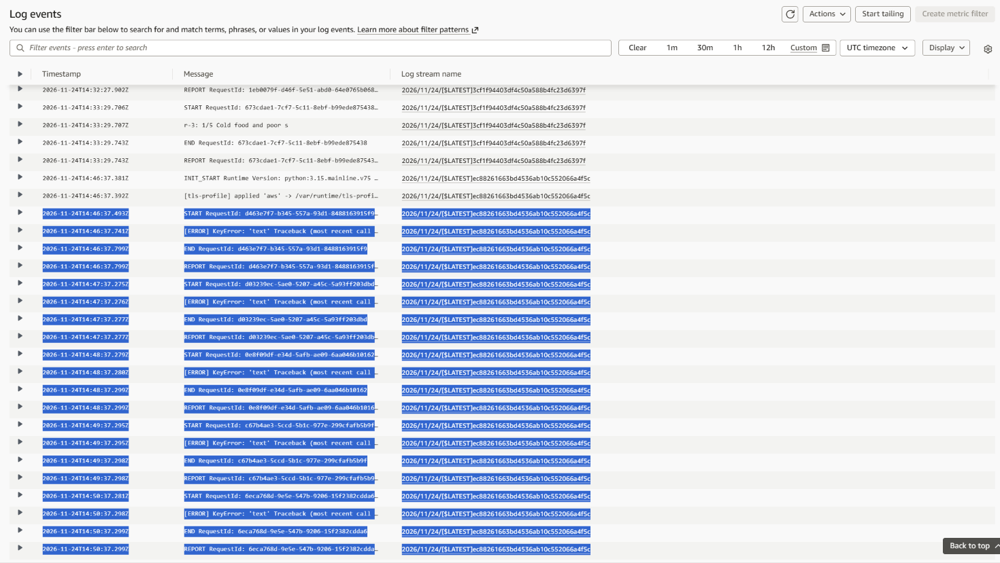

*Рисунок 3 — Пять неудачных вызовов Worker.*

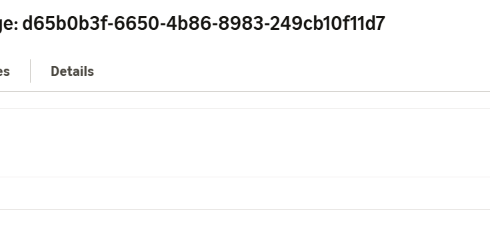

*Рисунок 4 — Отзыв без поля text в очереди ошибок.*

Обработчик исправлен: вместо обязательного обращения к полю используется получение значения по умолчанию, например `review.get('text', '')`. Сообщение возвращено через DLQ Redrive. При ошибке одного сообщения в пачке из десяти по умолчанию повторно доставляется вся пачка; частичные ответы о неудачных записях позволяют повторять только ошибочные сообщения.

### 3.4. Задание 4. Фильтрация плохих отзывов

Подтверждена email-подписка SNS. Фильтр по атрибуту `rating` применяется только к email-подписке, а очередь продолжает получать все отзывы. Условие соответствует оценкам ниже 3.

| Отзыв | Почта | Журнал Worker |
|---|---|---|
| rating = 1 | Да | Да |
| rating = 3 | Нет | Да |
| rating = 5 | Нет | Да |
| Без атрибута rating | Нет | Да |

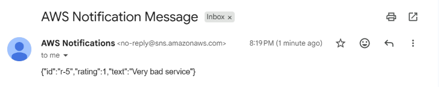

*Рисунок 5 — SNS доставила отзыв r-5 с оценкой 1.*

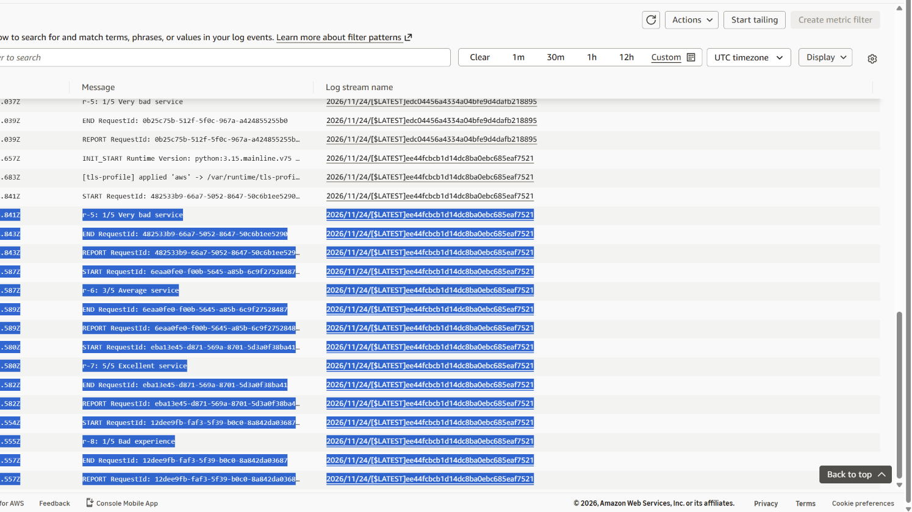

*Рисунок 6 — Обработка отзывов после исправления функции.*

Без атрибута `rating` сообщение не удовлетворяет фильтру подписки, даже если оценка присутствует в теле. При прямой отправке в несколько очередей издатель должен был бы знать адрес каждого получателя и изменяться при добавлении аналитики. SNS позволяет добавлять подписчиков без изменения издателя.

## 4. Часть II. TimeCapsule

### 4.1. Задание 5. Очередь писем и формат событий

Созданы `timecapsule-dev-events`, `timecapsule-dev-mail`, `timecapsule-dev-mail-dlq`. Очередь подписана на SNS с Raw message delivery. Политика очереди ограничивает отправку указанной темой. Используется SSE-SQS.

| Параметр | Значение | Причина |
|---|---|---|
| Visibility timeout | 180 с | Запас на обработку и подключение к БД |
| Retention | 4 дня | Время для исправления сбоя |
| Long polling | 20 с | Меньше пустых запросов |
| Maximum receives | 5 | Несколько попыток перед DLQ |

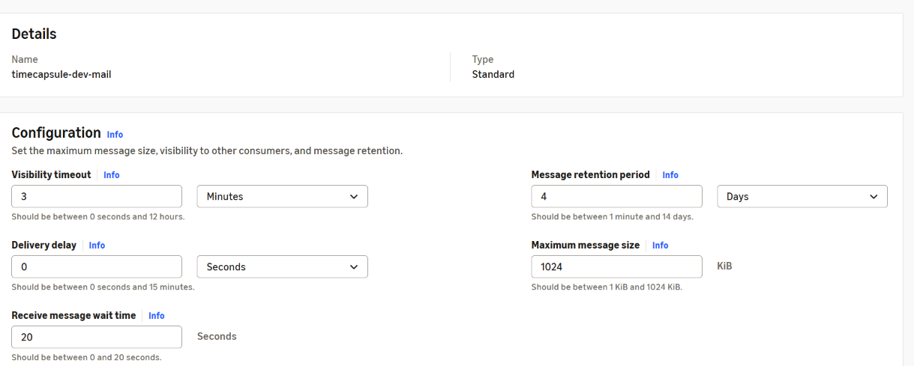

*Рисунок 7 — Параметры основной очереди TimeCapsule.*

Пример минимального события (ID приведён для иллюстрации):

```json
{"event_type":"capsule.sealed","capsule_id":12}
```

Получателю необходимы тип события и идентификатор капсулы. Остальные данные Mailer получает из PostgreSQL; пароли, содержимое капсулы и другие конфиденциальные сведения передавать не требуется. Форматы описываются в [docs/events.md](../events.md).

### 4.2. Задание 6. Lambda Mailer

Функция `timecapsule-dev-mailer` написана на Python. Драйвер `pg8000` и сертификат RDS `global-bundle.pem` включены в пакет развёртывания. Параметры подключения передаются через переменные окружения; значения секретов не публикуются. Функция работает в приватных подсетях VPC с группой `timecapsule-dev-lambda-sg`; RDS разрешает PostgreSQL TCP 5432 от этой группы. Роль `timecapsule-dev-mailer-role` предоставляет необходимые права, без ключей доступа в коде.

Mailer разбирает сообщение, проверяет тип `capsule.sealed`, читает данные капсулы, ждёт 3 секунды (`MAIL_DELAY_SECONDS`) и добавляет уведомление. Другие типы событий пропускаются. При успешном завершении служба Lambda удаляет обработанное сообщение из SQS.

Защита от повторов реализована на уровне PostgreSQL: уникальная комбинация `(capsule_id, event_type)` и вставка с `ON CONFLICT DO NOTHING`.

```sql
INSERT INTO notifications (capsule_id, user_id, recipient, message, event_type)
VALUES (%s, %s, %s, %s, %s)
ON CONFLICT (capsule_id, event_type) DO NOTHING;
```

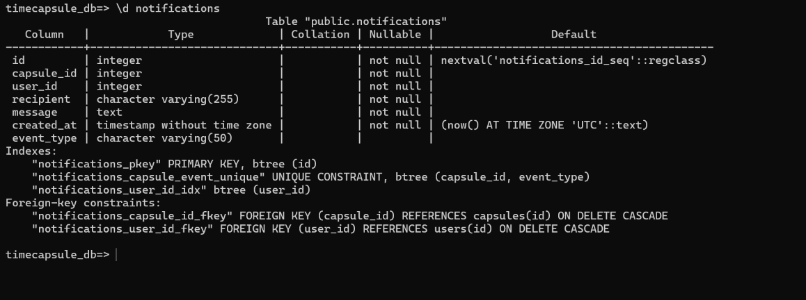

*Рисунок 8 — Структура notifications и уникальный индекс.*

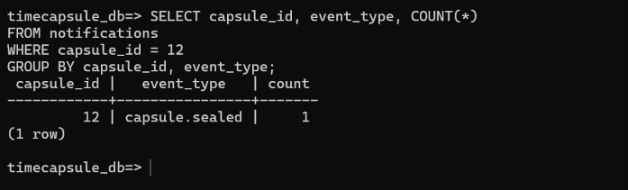

*Рисунок 9 — После двух одинаковых сообщений для капсулы 12 осталась одна запись.*

SQS допускает повторную доставку, поэтому проверка в базе обязательна. Каждый параллельный вызов открывает отдельное соединение с RDS; ограничение параллелизма необходимо выбирать с учётом мощности базы и числа подключений. **Точное установленное значение concurrency требуется сверить в конфигурации Mailer:** в архиве оно не показано.

### 4.3. Задание 7. Публикация из PHP-приложения

Синхронное создание уведомления заменено публикацией события `capsule.sealed` через AWS SDK for PHP. Политика `timecapsule-dev-app-events` разрешает `sns:Publish` для темы приложения и прикреплена к фактически используемой роли EC2 `timecapsule-dev-ec2-s3-role`. После сохранения капсулы PHP публикует событие и возвращает ответ, не ожидая Mailer.

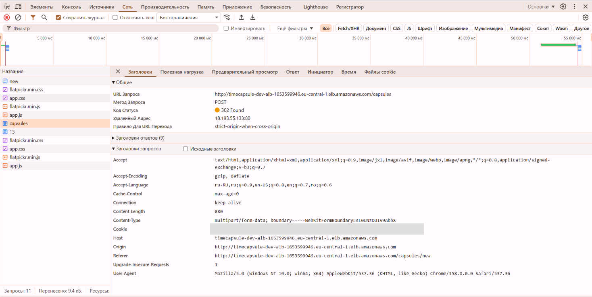

*Рисунок 10 — POST /capsules до переноса фоновой работы (вкладка Headers).* 

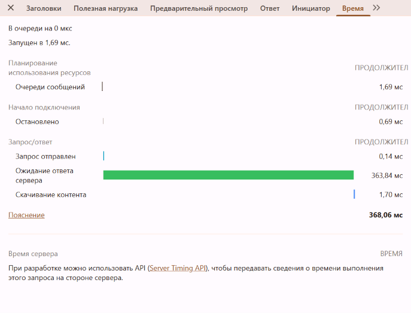

*Рисунок 11 — Время запроса после изменения: 368,06 мс.*

| Измерение | Время |
|---|---:|
| До изменения (зафиксировано при выполнении работы) | около 3,22 с |
| После изменения | 0,36806 с |
| Ускорение | около 8,75 раза |
| Сокращение времени | около 88,6% |

На исходном скриншоте до изменения открыты заголовки, а не Timing, поэтому численное значение до изменения основано на записи результата эксперимента, а не на видимом поле времени. Это отдельные измерения, не среднее нагрузочного теста.

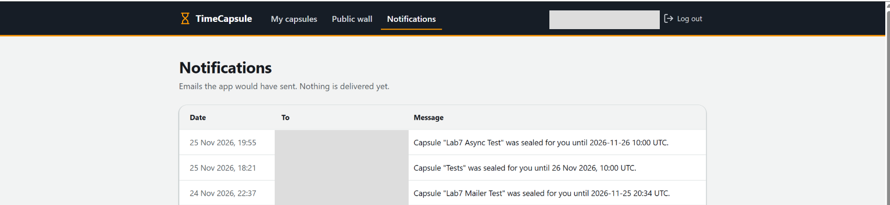

*Рисунок 12 — Уведомление о запечатывании Lab7 Async Test.*

При сбое Mailer пользователь может успешно запечатать капсулу, если публикация в SNS прошла успешно. Уведомление задержится в очереди или перейдёт в DLQ; ошибка фоновой функции не заставляет браузер ждать.

### 4.4. Задание 8. Автоматическое открытие капсул

Создана функция `timecapsule-dev-opener` (Python, 128 МБ, таймаут 30 секунд). Она подключается к RDS по TLS из приватных подсетей. В одной транзакции обновляются капсулы, время которых наступило, и добавляются уведомления `capsule.opened`.

```sql
UPDATE capsules c SET opened_at = CURRENT_TIMESTAMP
FROM users u
WHERE u.id = c.user_id
  AND c.opened_at IS NULL
  AND c.open_at <= CURRENT_TIMESTAMP
RETURNING c.id, c.user_id, c.title, COALESCE(c.recipient_email, u.email);
```

После commit функция возвращает объект с типом события, количеством и списком открытых капсул. Пример результата:

```json
{"event_type":"capsule.opened","opened_count":1,"capsules":[{"capsule_id":17,"title":"Final Lambda Opener Test"}]}
```

Расписание `timecapsule-dev-open-capsules` запускает функцию асинхронно каждую минуту, без гибкого окна. Для запуска создана отдельная роль Scheduler; существующее расписание остановки RDS сохранено. Выбраны 3 повторные попытки доставки Scheduler и максимальный возраст события 5 минут, чтобы не накапливать устаревшие запуски.

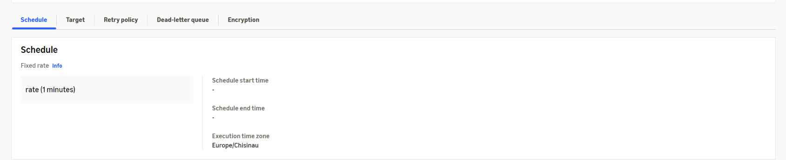

*Рисунок 13 — Период запуска раз в минуту.*

В Lambda настроено назначение **On success → SNS** для асинхронных вызовов. Публикует не код функции, а служба Lambda, используя разрешение `sns:Publish` роли Opener. SNS получает invocation record, где результат функции находится в `responsePayload`.

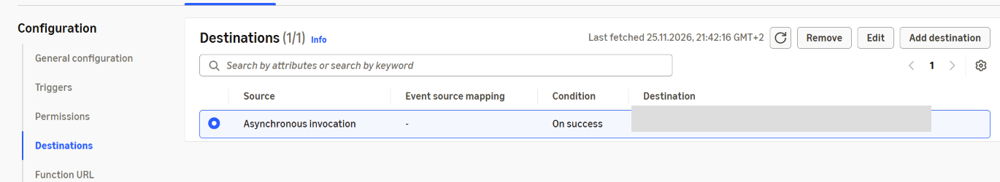

*Рисунок 14 — Асинхронное назначение успешных вызовов.*

Email-подписка фильтрует тело сообщения (`MessageBody`):

```json
{"responsePayload":{"event_type":["capsule.opened"],"opened_count":[{"numeric":[">",0]}]}}
```

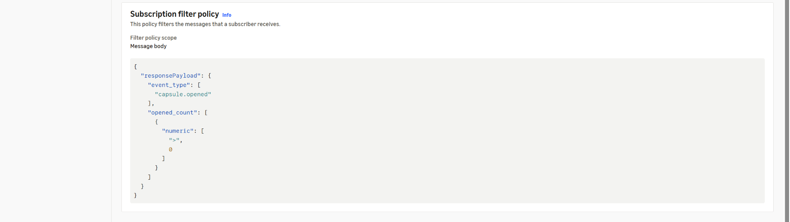

*Рисунок 15 — Фильтрация событий открытия.*

Проверка: создана капсула с открытием через четыре минуты, вкладка сайта закрыта. После наступления времени получено письмо SNS. Повторный тест `Final Lambda Opener Test` проведён после удаления старого PHP-механизма. Письмо содержит `condition: Success`, `opened_count: 1` и ID 17; в приложении появилось уведомление об открытии.

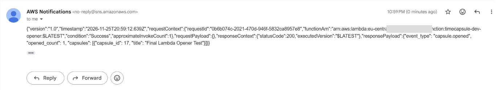

*Рисунок 16 — Письмо об открытии капсулы.*

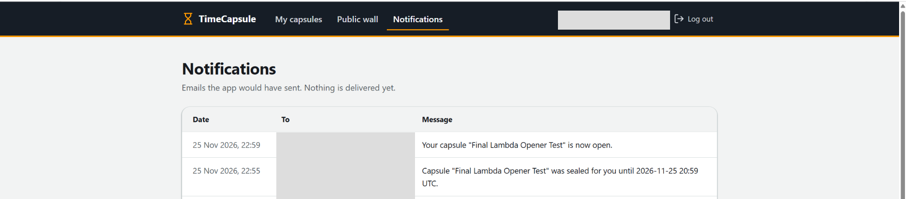

*Рисунок 17 — Уведомления о запечатывании и открытии тестовой капсулы.*

Из `public/index.php` удалён вызов `open_due_capsules()`, из `src/capsules.php` — сама функция. Обновлены комментарии в `src/controllers/notifications.php` и `src/mailer.php`. Создан новый AMI `timecapsule-dev-app-lab7-v3`, Launch Template версии 3 установлен по умолчанию, Instance Refresh завершён успешно. Через SSM проверен синтаксис PHP и отсутствие старого механизма на новых экземплярах.

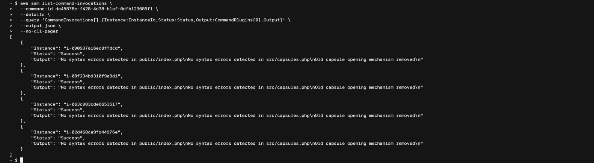

*Рисунок 18 — Проверка новой версии приложения на экземплярах ASG.*

Если обновление базы завершилось успешно, но Destination не доставил запись в SNS, капсула останется открытой и уведомление в базе сохранится, однако письмо может потеряться. Для прямой публикации из приватной подсети потребовался бы NAT Gateway или интерфейсный VPC endpoint SNS: оба имеют почасовую оплату и плату за трафик (endpoint — также по зонам); точная стоимость зависит от тарифа региона и времени работы. В выбранной схеме этих дополнительных сетевых расходов нет. Недостаток расписания — задержка до следующего запуска, обычно порядка минуты при исправной системе, а также регулярные вызовы даже без капсул.

### 4.5. Задание 9. Сбой обработчика и восстановление

Для эксперимента временно изменён пароль БД только у Mailer и уменьшен Maximum receives с 5 до 2. Запечатаны `DLQ Test 1` и `DLQ Test 2`. Веб-приложение продолжало принимать запросы, а функция завершалась ошибкой PostgreSQL `28P01`.

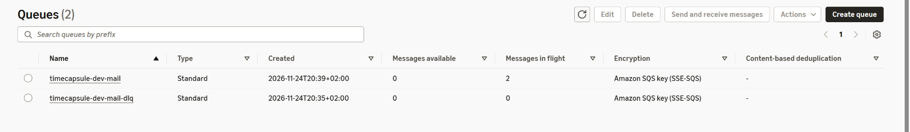

*Рисунок 19 — Два сообщения в обработке в основной очереди.*

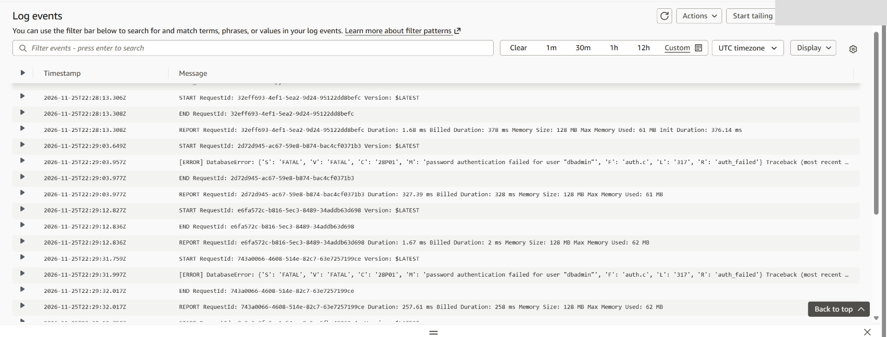

*Рисунок 20 — Ошибка аутентификации и повторные вызовы.*

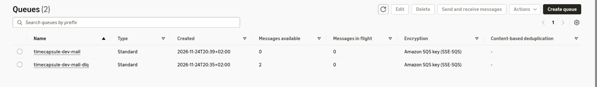

*Рисунок 21 — Два сообщения переместились в DLQ.*

После восстановления правильного пароля выполнен DLQ Redrive в исходную очередь. В CloudWatch появились записи о создании уведомлений для капсул 18 и 19, обе очереди опустели. При проверке приложения для каждой из двух тестовых капсул было по одному уведомлению. Maximum receives возвращён к 5.

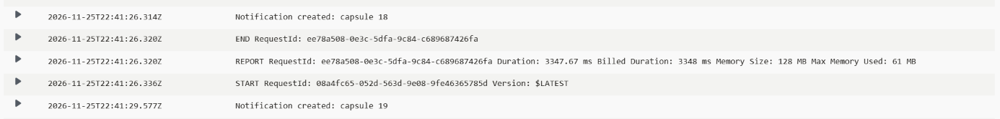

*Рисунок 22 — Успешная обработка двух капсул после Redrive.*

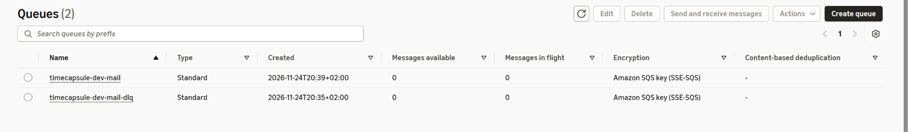

*Рисунок 23 — Обе очереди пусты.*

| Этап | Основная: доступно / в обработке | DLQ: доступно |
|---|---|---:|
| После отправки | 0 / 2 | 0 |
| После исчерпания получений | 0 / 0 | 2 |
| После Redrive | 0 / 0 | 0 |

Сообщения переместились после двух неудачных получений; интервал повторной доступности составлял около 180 секунд. Фактическое время перехода зависит также от опроса очереди и backoff Lambda. В ЛР6 отдельной очереди не было: ошибка синхронного создания уведомления могла нарушить веб-запрос, а автоматического восстановления письма через DLQ не существовало.

В архиве имеются снимки счётчиков SQS, но нет исторических графиков CloudWatch Monitoring и отдельного снимка уведомлений DLQ Test 1/2 после восстановления. Для полного соответствия требованиям следует добавить графики `ApproximateNumberOfMessagesVisible` и `ApproximateNumberOfMessagesNotVisible` за 25.11.2026, 22:28–22:42 UTC и, если доступно, итоговую страницу уведомлений.

### 4.6. Задание 10. Архитектура и ADR

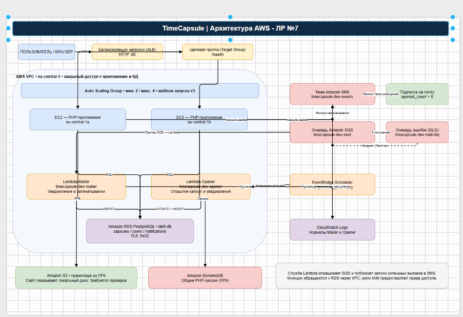

*Рисунок 24 — Обновлённая схема TimeCapsule.*

ALB и ASG продолжают обслуживать веб-запросы, а фоновые операции переданы Lambda. RDS хранит капсулы и уведомления. DynamoDB и S3 предусмотрены архитектурой предыдущей работы; при последней проверке интерфейс показывал локальное файловое хранилище, поэтому активное использование S3 в текущем развёртывании требует проверки.

| Вариант | Преимущество | Недостаток |
|---|---|---|
| Веб-запрос | Простота | Задержка ответа, зависимость от посещений |
| Cron на EC2 | Работа по расписанию | Нужен работающий сервер, координация нескольких EC2 |
| Lambda + SNS + SQS | Независимая обработка, повторы и DLQ | Дополнительная конфигурация, возможны дубликаты |

Выбран третий вариант. При остановке RDS Mailer повторяет обработку, затем сообщения могут перейти в DLQ; Opener обработает просроченные капсулы после восстановления базы. Уникальный индекс защищает уведомления от повторов. Полное решение: [ADR-0006](../adr/0006-background-jobs.md).

## 5. Контрольные вопросы

### 5.1. Как проходит событие от нажатия Seal capsule до строки в таблице notifications? Где оно может задержаться и где потеряться?

PHP сохраняет капсулу в RDS и публикует `capsule.sealed` в SNS, тема передаёт сообщение в SQS, а служба Lambda вызывает Mailer. Mailer читает данные и создаёт строку в `notifications`; при ошибке сообщение повторно доставляется или переходит в DLQ. Задержка возможна в очереди, при повторных попытках и недоступности БД. Потеря возможна при сбое публикации после сохранения капсулы, истечении срока хранения или неустранённой ошибке доставки.

### 5.2. Чем очередь SQS отличается от темы SNS и зачем нужны обе?

SNS распространяет событие всем подходящим подписчикам, а SQS хранит сообщения до обработки. SNS позволяет подключать новых получателей и фильтровать события, SQS обеспечивает буфер и повторную обработку при сбое. Вместе они разделяют издателя и обработчики.

### 5.3. Какую работу с SQS и SNS выполняет за Lambda-функции в VPC служба Lambda и почему им не нужен выход в интернет?

Служба Lambda опрашивает SQS, передаёт сообщения Mailer и удаляет успешно обработанные записи. Она также публикует invocation record успешного асинхронного вызова Opener в SNS через Destination. Код функций подключается только к приватной RDS, поэтому для этих операций не нужен NAT Gateway или SNS/SQS endpoint.

### 5.4. Как изменилась архитектура по сравнению с ЛР2? Какие обязанности перешли к AWS, а какие остались за вами?

Вместо одиночного веб-сервера используется масштабируемая архитектура с ALB, ASG, отдельной базой и управляемыми фоновыми сервисами. AWS управляет балансировкой, запуском функций, очередями, доставкой событий и расписанием. За разработчиком остаются бизнес-логика, настройки IAM и сети, защита от повторов, обработка ошибок, мониторинг и контроль расходов.

## 6. Репозитории и документация

- Репозиторий приложения: <!-- URL после публикации -->
- `timecapsule-mailer`: <!-- URL после публикации -->
- `timecapsule-opener`: <!-- URL после публикации -->
- [Форматы событий](../events.md) — объединить описание sealed и opened в одном файле.
- [ADR-0006](../adr/0006-background-jobs.md).
- [Схема архитектуры](screenshots/71.png).

В репозитории функций должны быть исходный код, `requirements.txt`, `.gitignore` и необходимый публичный CA-сертификат; ZIP-пакеты, установленные зависимости и секреты не публикуются.

## 7. Результаты и выводы

| Проверка | Результат |
|---|---|
| SNS → SQS → Worker | Отзывы обработаны |
| Ошибка отзыва и DLQ | Пять неудачных вызовов, восстановление |
| Email-фильтрация | Письмо о плохом отзыве |
| Идемпотентность Mailer | Одна запись для повторного события |
| Время Seal capsule | 3,22 с → 0,36806 с |
| Opener | Открытие без посещения сайта, письмо и уведомление |
| Обновление ASG | Версия 3, проверка новых EC2 |
| Сбой Mailer | Два сообщения в DLQ, затем успешно обработаны |
| Архитектура и ADR | Подготовлены |

**Вывод:** перенос фоновой работы в AWS Lambda уменьшил время ответа веб-приложения и устранил зависимость открытия капсул от посещения сайта. SNS и SQS обеспечили разделение компонентов, а DLQ позволила восстановить обработку после ошибки базы. При этом надёжность требует контроля сроков хранения, корректных IAM-разрешений, мониторинга и идемпотентности.

