# Лабораторная работа №3 — Сетевая инфраструктура AWS для TimeCapsule

**Студент:** Герганов Артём  
**Группа:** IA2404  
**Вариант:** `k = 6`  
**Уровень:** расширенное задание (Advanced)  
**Регион AWS:** Europe (Frankfurt), `eu-central-1`  
**Репозиторий GitHub:** _добавить ссылку на репозиторий_

## 1. Цель работы

Развернуть изолированную сеть AWS для веб-приложения **TimeCapsule**: создать VPC с публичными и приватными подсетями, настроить маршрутизацию и правила доступа, разместить PostgreSQL в приватной сети, обеспечить администрирование через Bastion Host и временный выход приватного сервера в интернет через NAT Gateway. Для расширенного задания — запустить приложение на отдельном EC2 из собственного AMI, подключить его к базе и настроить внутреннее DNS-имя.

## 2. Архитектура решения

Использована VPC `timecapsule-dev-vpc` с диапазоном `10.6.0.0/16`, двумя зонами доступности и четырьмя подсетями. В публичных подсетях размещаются сервер приложения и Bastion Host; PostgreSQL работает в приватной подсети без публичного IP-адреса.

| Компонент | Имя / адрес | Назначение |
|---|---|---|
| VPC | `timecapsule-dev-vpc`, `10.6.0.0/16` | Изолированная сеть проекта |
| Public A | `10.6.0.0/24`, `eu-central-1a` | Сервер приложения |
| Public B | `10.6.1.0/24`, `eu-central-1b` | Bastion Host |
| Private A | `10.6.10.0/24`, `eu-central-1a` | Сервер PostgreSQL |
| Private B | `10.6.11.0/24`, `eu-central-1b` | Резервная приватная подсеть |
| App Server | `10.6.0.211`, Elastic IP `52.57.44.67` | TimeCapsule, Nginx/PHP |
| Bastion | `10.6.1.249` | SSH-доступ к приватным ресурсам |
| DB Server | `10.6.10.131` | PostgreSQL 16 |
| Private DNS | `db.timecapsule.internal` | Внутреннее имя сервера БД |

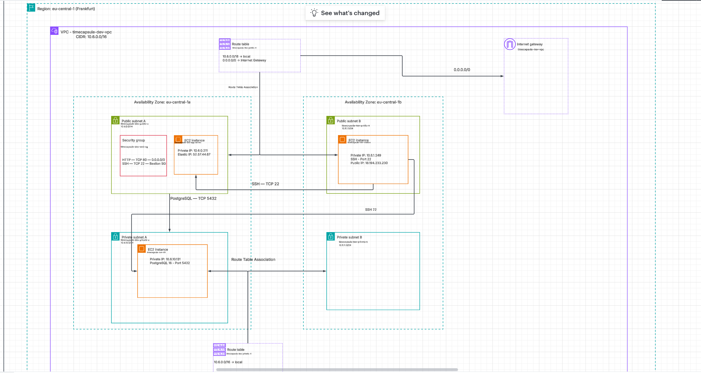

*Рис. 1. Схема VPC, двух зон доступности, подсетей, маршрутизации и серверов.*

## 3. Создание VPC и подсетей

В консоли **VPC** создана сеть `timecapsule-dev-vpc`. Затем созданы две публичные и две приватные подсети в разных Availability Zones. Такое разделение позволяет открыть веб-приложение пользователям, но не публиковать базу данных в интернете.

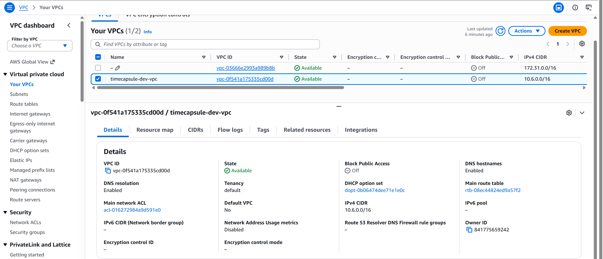

*Рис. 2. Созданная VPC с CIDR `10.6.0.0/16`.*

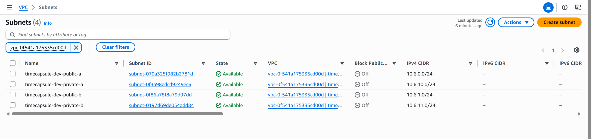

*Рис. 3. Четыре подсети проекта в двух зонах доступности.*

## 4. Маршрутизация

Для публичных подсетей создана таблица `timecapsule-dev-public-rt`: маршрут `10.6.0.0/16 → local` обеспечивает обмен внутри VPC, а `0.0.0.0/0 → Internet Gateway` — доступ к интернету. С таблицей связаны обе публичные подсети.

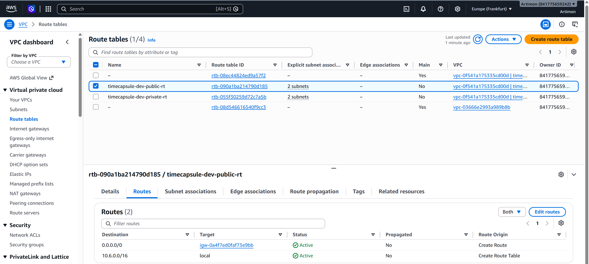

*Рис. 4. Маршруты публичной таблицы, включая Internet Gateway.*

Для приватных подсетей создана `timecapsule-dev-private-rt`. После завершения эксперимента с NAT в ней оставлен только маршрут `10.6.0.0/16 → local`, поэтому у DB Server отсутствует обычный маршрут в интернет.

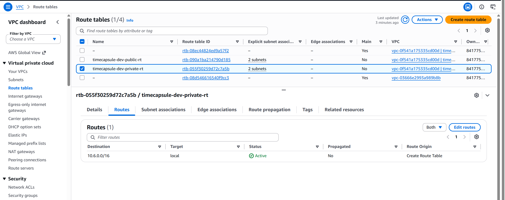

*Рис. 5. Финальное состояние приватной таблицы маршрутизации.*

Привязки двух публичных и двух приватных подсетей к соответствующим таблицам также проверены в AWS Console (дополнительные снимки `lab3-public-rt-subnets.png` и `lab3-private-rt-subnets.png` находятся в папке `screenshots`).

## 5. Security Groups и контроль доступа

Созданы три отдельные группы безопасности. Доступ разрешён только для необходимых направлений:

| Группа | Входящие правила | Зачем |
|---|---|---|
| `timecapsule-dev-bastion-sg` | SSH/TCP 22 с разрешённого внешнего IP | Администрирование Bastion |
| `timecapsule-dev-web-sg` | HTTP/TCP 80 из интернета; SSH/TCP 22 от Bastion SG | Публичный сайт и защищённый SSH |
| `timecapsule-dev-db-sg` | PostgreSQL/TCP 5432 от Web SG; SSH/TCP 22 от Bastion SG | База доступна только нужным EC2 |

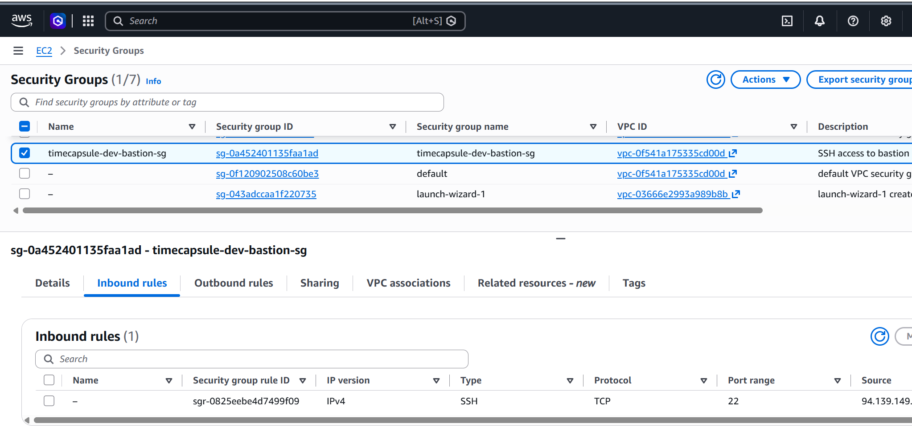

*Рис. 6. SSH-доступ к Bastion ограничен источником.*

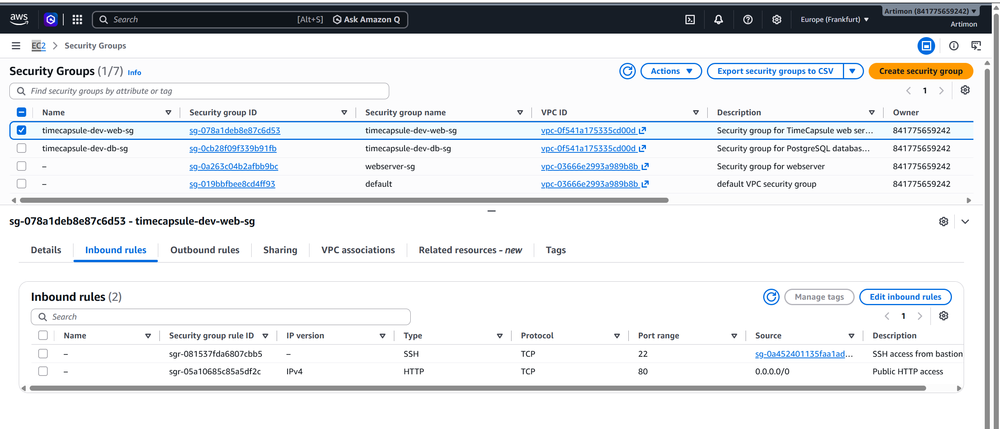

*Рис. 7. HTTP для пользователей и SSH только через Bastion.*

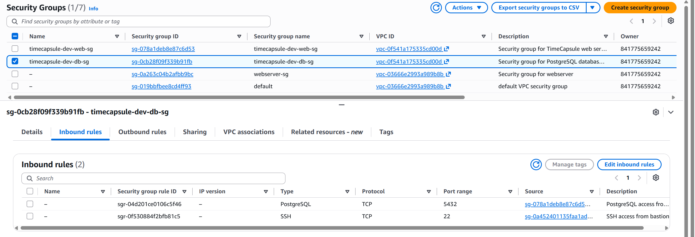

*Рис. 8. PostgreSQL доступен от группы приложения, SSH — от Bastion.*

## 6. Запуск EC2 и настройка PostgreSQL

Создан Bastion Host в публичной подсети. С него выполнено SSH-подключение к DB Server по приватному адресу. Сервер базы данных размещён в `private-a` без публичного IP. На нём установлен и запущен PostgreSQL, созданы база `timecapsule_db` и пользователь `timecapsule_user`.

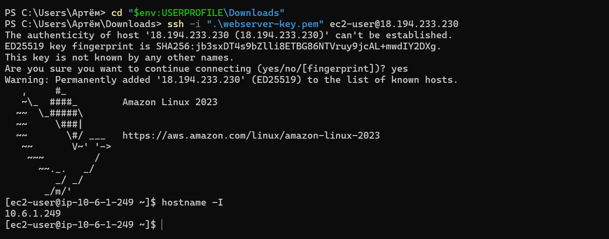

*Рис. 9. Подключение к Bastion Host.*

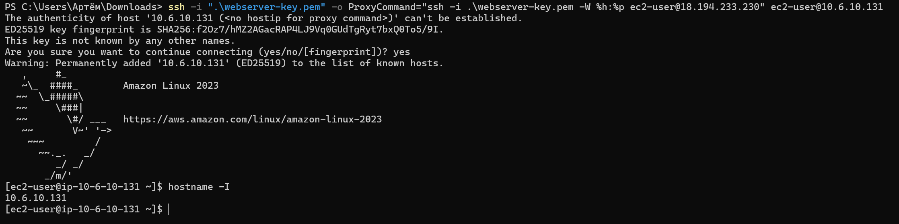

*Рис. 10. Доступ к приватному DB Server через Bastion.*

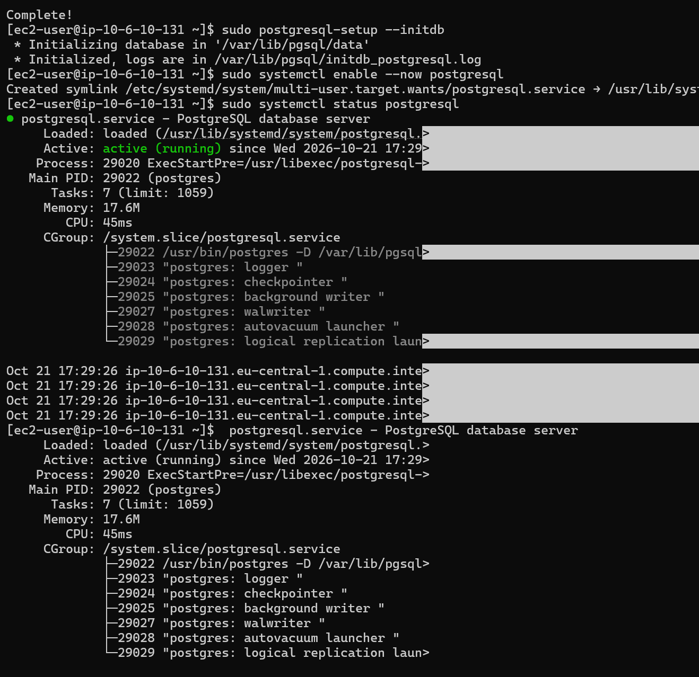

*Рис. 11. Установка и запуск PostgreSQL на приватном EC2.*

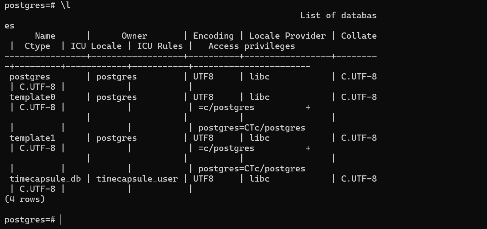

*Рис. 12. Проверка базы и таблиц PostgreSQL.*

Проверено подключение к PostgreSQL по TCP-порту `5432` из разрешённой сетевой зоны приложения. Это подтверждает работу правил Security Group и связи между подсетями.

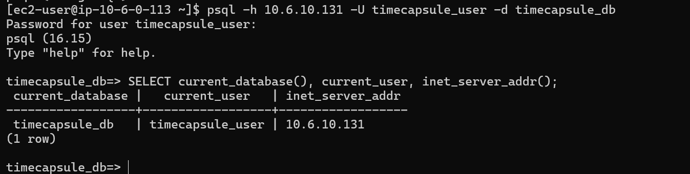

*Рис. 13. Соединение Web Server с PostgreSQL.*

## 7. Временный интернет-доступ через NAT Gateway

Приватному DB Server временно понадобился доступ к внешним репозиториям для установки и обновления пакетов. Для этого был создан **NAT Gateway** в публичной подсети и добавлен маршрут `0.0.0.0/0` из приватной таблицы в NAT. Выход в интернет проверен с DB Server.

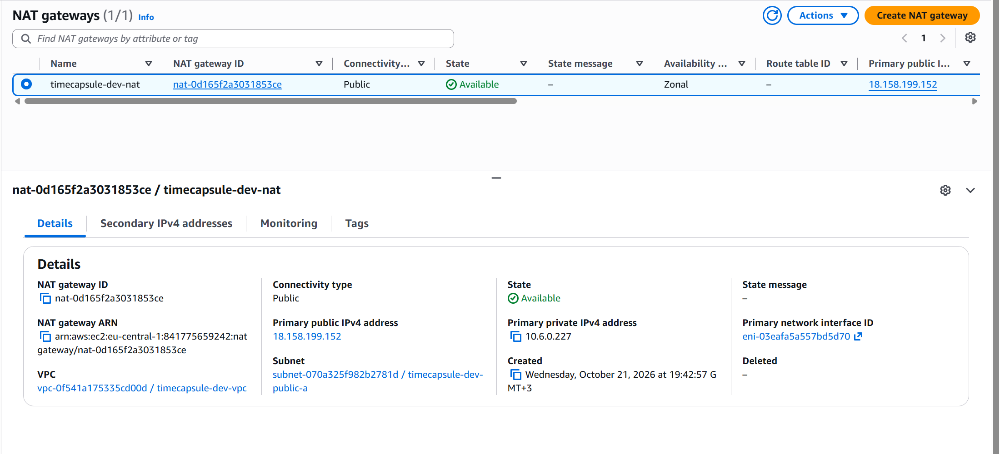

*Рис. 14. NAT Gateway в состоянии Available.*

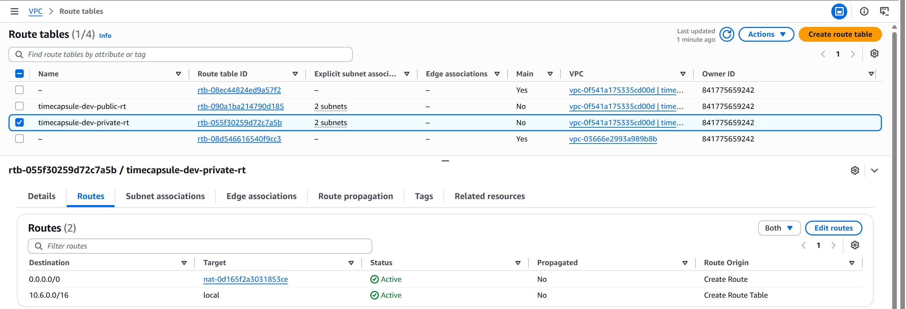

*Рис. 15. Временный маршрут приватной сети через NAT.*

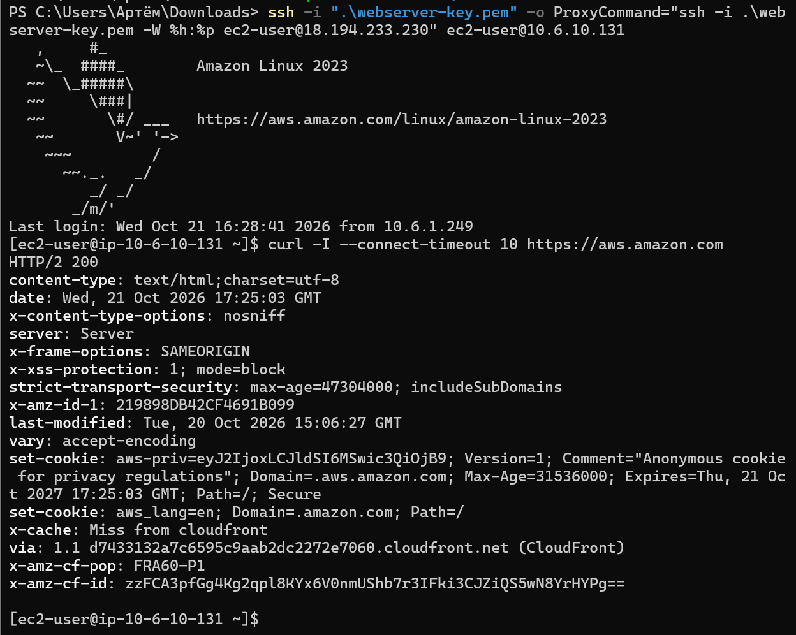

*Рис. 16. Проверка доступа к интернету с DB Server.*

После эксперимента NAT Gateway удалён. Во время удаления маршрут временно отображался как `Blackhole`; затем маршрут в NAT удалён, и приватная таблица вернулась к состоянию с одним локальным маршрутом.

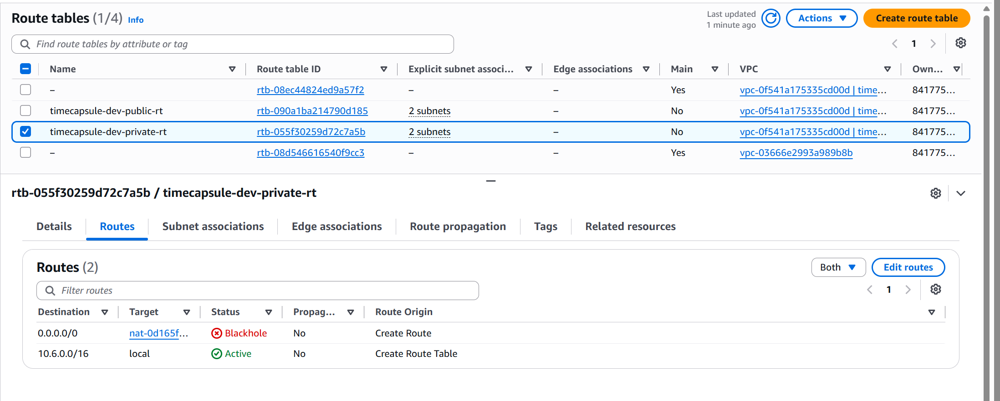

*Рис. 17. Неактивный маршрут после удаления NAT Gateway.*

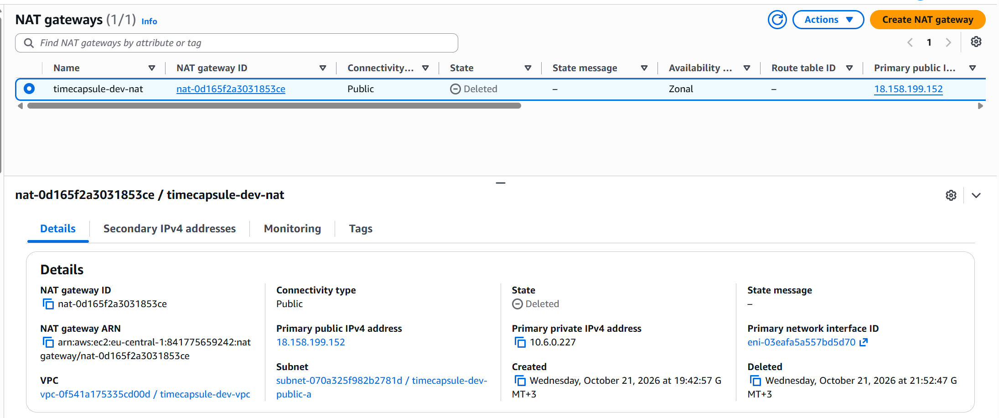

*Рис. 18. Удалённый NAT Gateway.*

## 8. Проверка Network ACL

Для демонстрации сетевой фильтрации создан тестовый **Network ACL**. При запрете трафика PostgreSQL на порту `5432` соединение перестало работать. После возврата разрешающих правил доступ восстановился. Таким образом, на практике показано различие между доступом при разрешённых и запрещённых сетевых правилах.

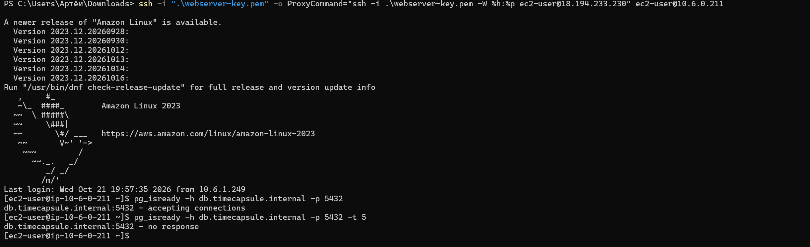

*Рис. 19. Подключение к PostgreSQL блокируется при тестовом ограничении NACL.*

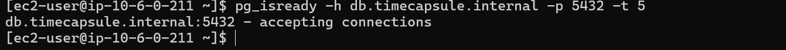

*Рис. 20. Соединение восстановлено после отмены ограничения.*

## 9. Развёртывание TimeCapsule на отдельном App Server

Для расширенного задания подготовлен собственный **AMI** на основе ранее настроенного веб-сервера. Из этого образа запущен новый EC2 `timecapsule-dev-app-server` с приложением TimeCapsule. Для постоянного внешнего адреса выделен и привязан **Elastic IP** `52.57.44.67`. Проверено открытие страницы приложения в браузере.

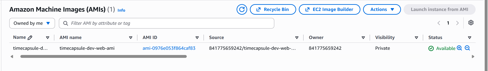

*Рис. 21. Собственный AMI доступен для запуска нового EC2.*

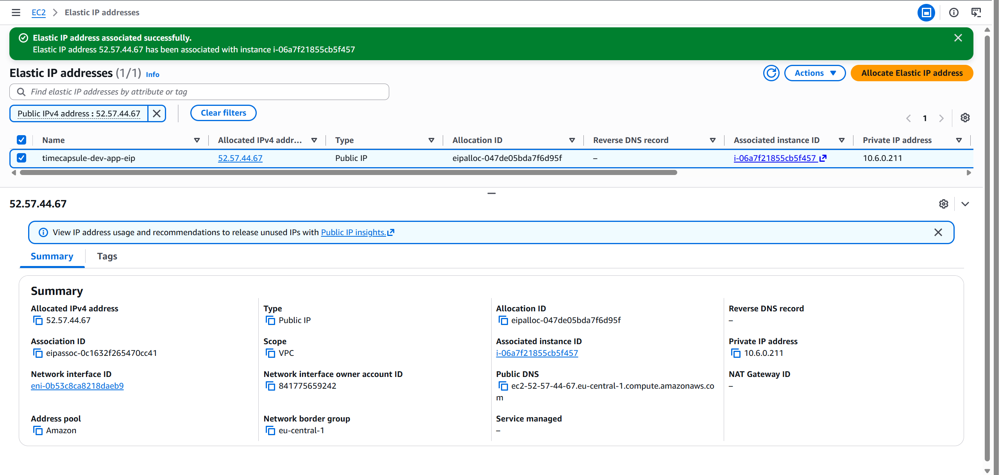

*Рис. 22. Elastic IP привязан к App Server.*

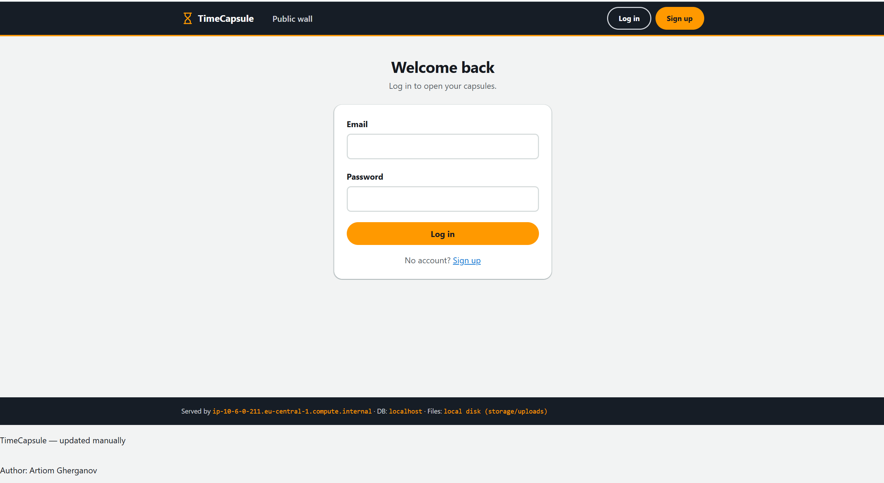

*Рис. 23. TimeCapsule открывается на новом сервере.*

На App Server настроено подключение к вынесенной PostgreSQL. Проверено выполнение SQL-запросов к базе. Старый веб-сервер остановлен, а новый сервер приложения продолжил работу, что показывает перенос веб-части на отдельный EC2.

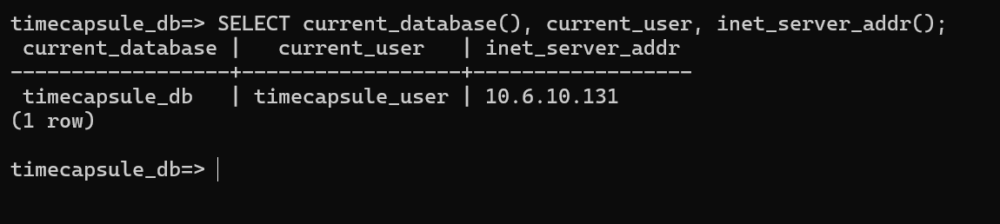

*Рис. 24. Запрос к PostgreSQL с нового App Server.*

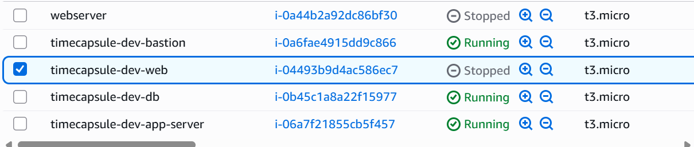

*Рис. 25. Старый веб-сервер остановлен, новый App Server работает.*

## 10. Внутренний DNS через Route 53

Создана **Private Hosted Zone** `timecapsule.internal` и A-запись `db.timecapsule.internal → 10.6.10.131`. Благодаря этому приложение обращается к базе по DNS-имени, а не по жёстко указанному приватному IP. Разрешение имени и подключение к PostgreSQL по DNS проверены из сети AWS.

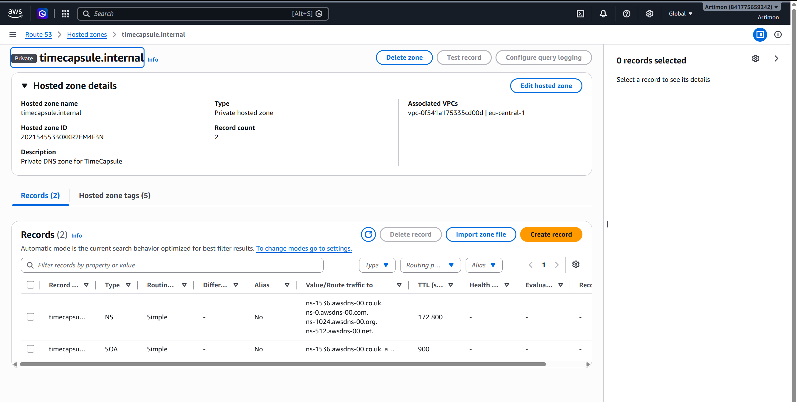

*Рис. 26. Приватная DNS-зона Route 53.*

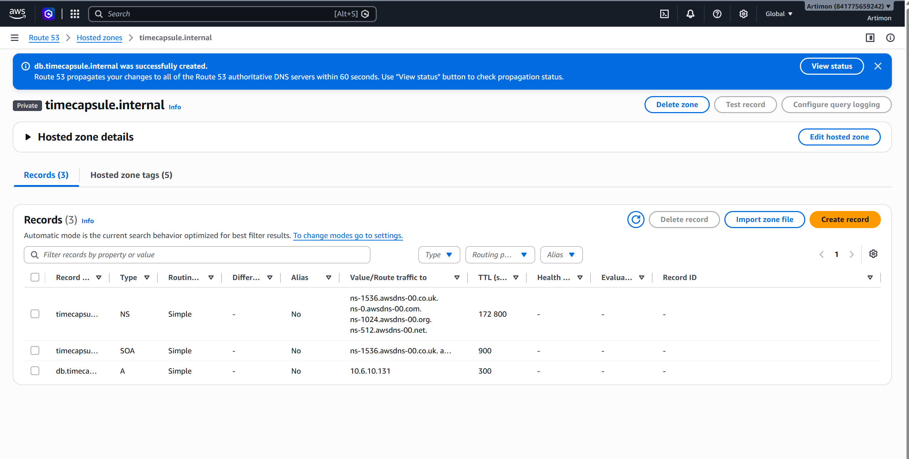

*Рис. 27. A-запись для DB Server.*

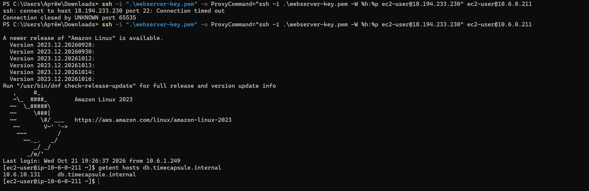

*Рис. 28. Проверка разрешения внутреннего DNS-имени.*

## 11. Итоговое состояние и безопасность

В результате получена трёхуровневая инфраструктура: публичное приложение, отдельный Bastion Host и приватная PostgreSQL. Пользователи обращаются к TimeCapsule по HTTP через Elastic IP; соединение приложения с базой проходит внутри VPC на TCP/5432. Для администрирования приватного сервера используется Bastion. Постоянный NAT Gateway не оставлен, чтобы не создавать ненужные расходы.

**Что подтверждено приложенными скриншотами:** VPC и подсети, таблицы маршрутизации, три Security Group, SSH через Bastion, работа PostgreSQL, временный NAT и его удаление, тест NACL, собственный AMI, Elastic IP, веб-приложение, связь App–DB и приватный DNS.

**Что требует отдельного подтверждения, если преподаватель проверяет каждый пункт расширенного задания:** поиск ресурсов по тегу `Project=timecapsule` в Tag Editor; выполнение миграции командой `psql -f`; ответ `/health` при работающей и остановленной БД; изменение страницы с текстом `LR3`; проверка приватного DNS с локального ПК; сценарии `nat-up.sh`/`nat-down.sh` (если выбран вариант со скриптами); ссылка на ADR и GitHub. В предоставленном архиве нет однозначных скриншотов всех этих действий, поэтому они не обозначены как доказанно выполненные.

## 12. Ответы на контрольные вопросы

**Почему база данных размещена в приватной подсети?** Чтобы к ней нельзя было напрямую подключиться из интернета. PostgreSQL принимает подключения только от разрешённой Security Group приложения, а SSH — от Bastion Host.

**Для чего нужны Internet Gateway и NAT Gateway?** Internet Gateway обеспечивает выход публичных ресурсов в интернет при наличии соответствующих маршрутов и публичной адресации. NAT Gateway позволяет приватному EC2 инициировать исходящие подключения в интернет, не открывая прямой входящий доступ к нему.

**Чем Security Group отличается от Network ACL?** Security Group действует на уровне сетевого интерфейса ресурса и отслеживает состояние соединений. Network ACL применяется на уровне подсети, является stateless и позволяет явно задавать правила разрешения и запрета трафика.

**Зачем использовать Route 53 Private Hosted Zone?** Она даёт внутреннее DNS-имя, доступное внутри связанных VPC. Приложение может использовать `db.timecapsule.internal` вместо конкретного IP, что упрощает изменение адреса DB Server.

**Зачем нужен Bastion Host?** Он служит контролируемой точкой SSH-доступа к приватным EC2. Администратору не требуется выдавать серверу базы данных публичный IP-адрес.

## 13. Вывод

В ходе лабораторной работы была построена сеть AWS для TimeCapsule с разделением публичных и приватных ресурсов. Были настроены маршруты, группы безопасности и доступ к PostgreSQL через Bastion; проверены временный интернет-доступ через NAT Gateway и блокировка трафика средствами NACL. Для расширенного задания приложение перенесено на отдельный EC2 из собственного AMI, закреплено за Elastic IP и подключено к приватной базе по внутреннему DNS-имени Route 53. Работа показала, как изолировать базу данных, управлять сетевым доступом и разворачивать приложение в более безопасной архитектуре AWS.

